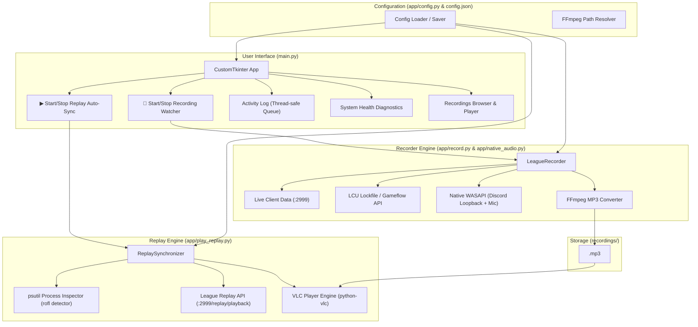

# AGENTS.md — League Voice Recorder & Replay Synchronizer

Welcome to the **League Voice Recorder** project documentation. This document is designed for AI agents and developers to understand the architecture, data flows, APIs, and operational nuances of the entire codebase.

---

## 1. Project Purpose & Core Concept

In competitive League of Legends scrimmages and team matches, reviewing gameplay with synchronized team communications is critical. 

This project solves two primary problems:
1. **Automated Scrim Voice Recording (`record.py`)**: Monitors the active League of Legends client. When a match starts, it automatically captures team Discord voice chat (via WASAPI loopback) along with the player's microphone and records them directly via native WASAPI loopback. It dynamically pauses/unpauses recording if the game pauses, stops when the game ends, extracts the official Riot Game ID, and converts the recording into a compressed `.mp3` file named `<GameID>.mp3`.
2. **Automated Replay Audio Synchronization (`play_replay.py`)**: When the user opens any `.rofl` replay in the League client, it detects the running replay, parses the Game ID from the file name, locates the matching `<GameID>.mp3`, and plays the audio in VLC while continuously synchronizing playback time and playback speed (0.5x, 1x, 2x, 4x, etc.) with the League replay playback API.

The project provides both:
- A modern dark-mode desktop GUI (`main.py` using `customtkinter`) with **2 primary buttons** ("Start Recording Watcher" and "Start Replay Auto-Sync").
- Standalone CLI execution for headless or script-based workflows.

---

## 2. Repository & Package Structure

```text
League Voice Recorder/
│
├── main.py                 # Primary Desktop GUI application entrypoint
├── start_ui.bat            # Windows quick-launcher for the GUI
├── run_tests.bat           # Automated test suite runner batch script
├── build_exe.bat           # Standalone Windows .exe compiler batch script
│
├── app/                    # Core Python application package
│   ├── __init__.py         # Package marker
│   ├── config.py           # Configuration loader, saver, and path resolver
│   ├── discord_ipc.py      # Discord Local IPC client (live mute/deafen tracking)
│   ├── i18n.py             # Internationalization and community translation loader
│   ├── record.py           # LeagueRecorder engine (WASAPI capture & FFmpeg alignment)
│   ├── native_audio.py     # Native WASAPI audio capture (Discord loopback & mic)
│   └── play_replay.py      # ReplaySynchronizer engine (process watcher & VLC sync)
│
├── assets/                 # Visual branding assets (icons, logos)
│   ├── icon.ico            # Windows executable multi-resolution icon
│   ├── icon.png            # PNG logo graphic
│   └── icon.svg            # Scalable vector logo
│
├── locales/                # Community and built-in i18n translation JSON files
│   ├── en.json             # English (default fallback)
│   └── hu.json             # Hungarian
│
├── tests/                  # Automated test suite (40 unittests)
│   ├── __init__.py
│   ├── test_config.py      # Config defaults, path resolution, and directory creation
│   ├── test_discord_ipc.py # Discord Local IPC & mute silence injection
│   ├── test_i18n.py        # Locale discovery, translation lookup, and key parity
│   ├── test_recorder.py    # FFmpeg sample-accurate offset alignment & replay guard
│   ├── test_replay_sync.py # ROFL Game ID extraction & volume clamping
│   └── test_ui.py          # CustomTkinter headless UI & live language switching
│
├── .env.example            # Environment variables template
├── pyproject.toml          # Project dependencies and tool configurations
├── ruff.toml               # Linter rules and exclusions
└── requirements.txt        # Frozen dependencies export
```

---

## 3. System Architecture



---

## 3. Component Reference

### 3.1 `main.py`
The desktop GUI application built using `customtkinter`.
- **Primary Controls**:
  - `🔴 Start Recording Watcher` / `⏹ Stop Recording Watcher`: Toggles the recording watcher thread (`LeagueRecorder.run_loop()`).
  - `▶ Start Replay Auto-Sync` / `⏹ Stop Replay Auto-Sync`: Toggles the replay sync watcher thread (`ReplaySynchronizer.run_loop()`). No manual file selection is needed; it detects and synchronizes automatically.
- **Header & System Health**:
  - Real-time diagnostics for Discord voice capture, League Client process, VLC 64-bit engine, and FFmpeg binary.
- **Tabbed Center Area**:
  - **Activity Log**: Thread-safe monospace log terminal displaying live events with timestamps and auto-scroll.
  - **Scrim Recordings**: File manager showing recorded `.mp3` files, sizes, creation timestamps, with "Play in VLC" and "Open in Explorer" actions.
  - **Settings**: Configuration editor for recording folder, VLC directory, polling intervals, replay volume, and interface language.

### 3.2 `record.py` (`LeagueRecorder`)
Responsible for live match detection, native WASAPI voice capture, and audio export.
- **League Match Detection & Zero-Latency Start**:
  - Uses a persistent HTTP keep-alive session (`requests.Session()`) polling `https://127.0.0.1:2999/liveclientdata/allgamedata`.
  - **Zero-Latency Start**: When a live match begins, `start_recording(initial_game_time)` triggers Native WASAPI recording directly in under 1 millisecond.
  - **Sample-Accurate Audio Alignment**:
    - Stores `first_game_time` at the exact moment recording begins.
    - If recording starts after 00:00 (`first_game_time > 0`), FFmpeg automatically prepends exact silence using `-af adelay=delays={delay_ms}:all=1`.
    - If recording starts before 00:00 during countdown (`first_game_time < 0`), FFmpeg automatically trims the pre-game countdown using `-ss {abs(offset):.3f}`.
    - This guarantees that 00:00:00 in the MP3 file is aligned frame-by-frame with League match time `game_time = 0.000`.
  - **Replay Protection (`check_if_game_is_replay`)**: Checks process command-line arguments and cached PID for `.rofl` files. If a replay is active, live match recording is aborted/prevented.
  - Pause detection: If `gameTime == last_game_time` (and `gameTime > 0`), pauses native recording.
  - Resume detection: If `gameTime > last_game_time` while paused, resumes native recording.
  - Match end: When the game client closes, the request raises `RequestException`, which triggers `stop_recording_and_rename()`.
- **Game ID Extraction**:
  - Uses `find_league_install_dir()` (prioritizing fast `psutil` lookup of `LeagueClientUx`, falling back to PowerShell and common drive paths).
  - Reads `lockfile` (`<name>:<pid>:<port>:<password>:<protocol>`).
  - Authenticates with Basic Auth `riot:<password>` to query `https://127.0.0.1:{port}/lol-gameflow/v1/session` to obtain `gameData.gameId`.
- **Native WASAPI Capture (`native_audio.py`)**:
  - Captures Discord voice chat directly via Windows WASAPI Process Loopback.
  - Captures player microphone via sounddevice.
  - Tracks Discord mute & deafen state in real time via local IPC (\\.\pipe\discord-ipc-*). When muted, feeds synchronized silence bytes to keep timeline aligned.
  - Automatically mixes and normalizes both streams into sample-accurate <GameID>.mp3.

### 3.3 `play_replay.py` (`ReplaySynchronizer`)
Responsible for detecting opened `.rofl` replays and synchronizing audio playback in VLC.
- **Replay Process Detection (`detect_running_rofl_file`)**:
  - Scans active processes using `psutil.process_iter(["name", "cmdline"])`.
  - Looks for `League of Legends.exe` containing command-line arguments ending in `.rofl`.
- **Game ID Parsing (`parse_rofl_game_id`)**:
  - Parses replay filenames such as `EUW1-8018190134.rofl` or `8018190134.rofl` to extract `8018190134`.
  - Matches the file directly to `recordings/8018190134.mp3`.
- **Volume Control (`set_volume`)**:
  - Exposes dynamic volume control (0% to 100%) controllable via the UI slider.
  - Automatically updates VLC player volume in real-time (`player.audio_set_volume(self.volume)`).
  - Preserves user preference in `REPLAY_VOLUME` (`.env` & `config.json`).
- **Replay Playback API Polling (`run_sync_loop`)**:
  - Polls `https://127.0.0.1:2999/replay/playback` every 50ms.
  - JSON payload fields:
    - `time`: Current replay playback time in seconds (float).
    - `paused`: Boolean flag indicating if replay is currently paused.
    - `speed`: Playback rate multiplier (e.g. 0.5, 1.0, 2.0, 4.0).
  - Sync actions:
    - Rate change: Calls `player.set_rate(replay_speed)`.
    - Time seek / drift: If `abs(game_time - last_game_time) > 2.0`, calls `player.set_time(int(game_time * 1000))`.
    - Rewind handling: If `player.get_state() == vlc.State.Ended`, automatically reloads media before seeking.
    - Pause: If `paused == True` or `game_time <= 0.5`, calls `player.pause()`.
  - Auto-exit: If the Replay API fails 8 consecutive times (replay closed), it stops VLC and returns to the watcher loop.

### 3.4 Configuration & Secrets (`config.py`, `.env`, `.env.example`, `.gitignore`)
- **Environment & Secrets (`.env` and `.env.example`)**:
  - Configuration values are safely stored in `.env` and `config.json`.
  - `.env.example` provides a tracked template for new setups with placeholder values.
  - `.env` and `config.json` are both excluded in `.gitignore` to prevent credential exposure.
- **Config Manager (`config.py`)**:
  - Dynamically loads `.env` variables via `python-dotenv`.
  - Falls back to `config.json` or built-in defaults.
  - Exposes `load_config()`, `save_config(dict)` (which keeps `.env` and `config.json` synchronized), and `get_ffmpeg_path()`.
- **Git Ignore Policy (`.gitignore`)**:
  - Ignores secrets (`.env`, `config.json`).
  - Ignores large local binaries (`ffmpeg.exe`, `redist/` installer).
  - Ignores recordings (`recordings/*`, preserving `.gitkeep`).
### 3.5 Internationalization & Community Translations (`i18n.py` & `locales/`)
- **Default Language**: English (`en.json`) is the default language.
- **Built-in Translations**:
  - English (`locales/en.json`)
  - Hungarian (`locales/hu.json`)
- **Extensible Architecture for Community Contributions**:
  - Anyone can contribute a new translation simply by adding a new `<code_name>.json` file inside `locales/` (e.g. `locales/de.json`, `locales/fr.json`, `locales/es.json`).
  - Each JSON file should define `"__language_name__": "<Native Name>"` (e.g., `"Deutsch"`, `"Français"`, `"Español"`).
  - The application automatically scans the `locales/` directory on startup and populates the **Interface Language** dropdown menu in Settings with all detected languages—**no Python code modifications required**.
- **Dynamic Language Switching**:
  - Changing the language dropdown immediately translates all widgets, status pills, health badges, button labels, and tabs in real-time via `on_language_change` listeners.
  - Automatically persists the language preference to `config.json` and `.env` (`LANGUAGE=<code_name>`).
- **Safe Fallback**:
  - `t(key, **kwargs)` resolves nested dot-notated keys (e.g. `record.start_btn`).
  - If a key is missing in a community translation, it automatically falls back to English (`en.json`). If missing in both, it returns the raw key.

---

## 4. League of Legends APIs Reference

| API | URL / Protocol | Authentication | Purpose |
| :--- | :--- | :--- | :--- |
| **Live Client Data API** | `https://127.0.0.1:2999/liveclientdata/allgamedata` | None (SSL verify=False) | Read `gameData.gameTime` during live games |
| **Replay Playback API** | `https://127.0.0.1:2999/replay/playback` | None (SSL verify=False) | Read `time`, `paused`, `speed` during replay (requires `EnableReplayApi=1` in `Config\game.cfg`) |
| **LCU Gameflow API** | `https://127.0.0.1:{port}/lol-gameflow/v1/session` | Basic Auth (`riot:<lockfile_pw>`) | Retrieve real match `gameId` from client |

> [!NOTE]
> Port `2999` uses a self-signed Riot Games SSL certificate. All HTTP requests must set `verify=False` and disable `urllib3` warnings.

---

## 5. Development & Execution Guide

### 5.1 Environment & Package Manager
The project uses `uv` for Python virtual environment and dependency management.

```powershell
# Run the UI application
uv run main.py

# Or run via launcher script
.\scripts\start_ui.bat

# Run the recorder standalone (CLI)
uv run python -m app.record

# Run the replay synchronizer standalone (CLI)
uv run python -m app.play_replay
```

### 5.2 Dependency Management
Dependencies are defined in `pyproject.toml` and locked in `uv.lock`. `requirements.txt` is exported via:
```powershell
uv export --no-dev --no-hashes -o requirements.txt
```

Core libraries:
- `customtkinter`: Modern dark-themed UI components.
- `psutil`: High-performance cross-platform process management.
- `python-vlc`: libvlc bindings for audio playback and rate synchronization.
- `requests` & `urllib3`: HTTPS communication with League local APIs.

### 5.3 Automated Testing & Code Quality
The project includes a comprehensive suite of 26 unit tests covering configuration, i18n key parity and translations, recorder sample-accurate audio alignment and replay protection, replay synchronizer game ID parsing and volume clamping, and headless CustomTkinter UI rendering.

```powershell
# Run the test suite via the Windows batch launcher
.\scripts\run_tests.bat

# Or run tests directly with uv
uv run python -m unittest discover tests -v

# Run the linter
uvx ruff check .
```

### 5.4 Standalone Executable Packaging
The application is compiled into a standalone Windows binary distribution using `Nuitka` in `--standalone` mode.
- Built via batch script: `.\scripts\build_exe.bat`
- Output directory: `dist/LeagueVoiceRecorder/` containing:
  - `LeagueVoiceRecorder.exe`: Standalone binary with instant startup (<100ms) and zero runtime extraction overhead.
  - Python runtime DLL, dependency libraries, and Tkinter assets.
  - `locales/` directory for built-in and community translation JSON files.
- Automatically creates `config.json` next to the binary on first run.

---

## 6. Key Invariants & Design Rules

1. **Thread Safety**: Never call Tkinter/CustomTkinter widget manipulation methods directly from background worker threads. Always post updates through `self.msg_queue` and consume them in `_process_queue` on the main GUI thread.
2. **CLI Executability**: `app/record.py` and `app/play_replay.py` remain directly executable from the command line (`if __name__ == "__main__":` via `python -m app.record` and `python -m app.play_replay`). Never remove standalone support when adding UI capabilities.
3. **Recording Safety**: When stopping the recorder (either via the UI button or on application close), if an active recording is in progress, `stop_recording_and_rename()` must be called to ensure the recording is finalized and converted to MP3.
4. **VLC Initialization**: On 64-bit Windows, VLC requires explicit DLL directory registration before importing `vlc`. Always configure `os.add_dll_directory(VLC_DIR)` and ensure fallback audio output drivers (`--quiet`, `--quiet --aout=mmdevice`, `--quiet --aout=directsound`) are handled.
5. **Fast Process Lookup**: Always use `psutil` before falling back to PowerShell subprocess calls for detecting `LeagueClientUx.exe` and `League of Legends.exe`. `psutil` executes in single-digit milliseconds without spawning console windows.


