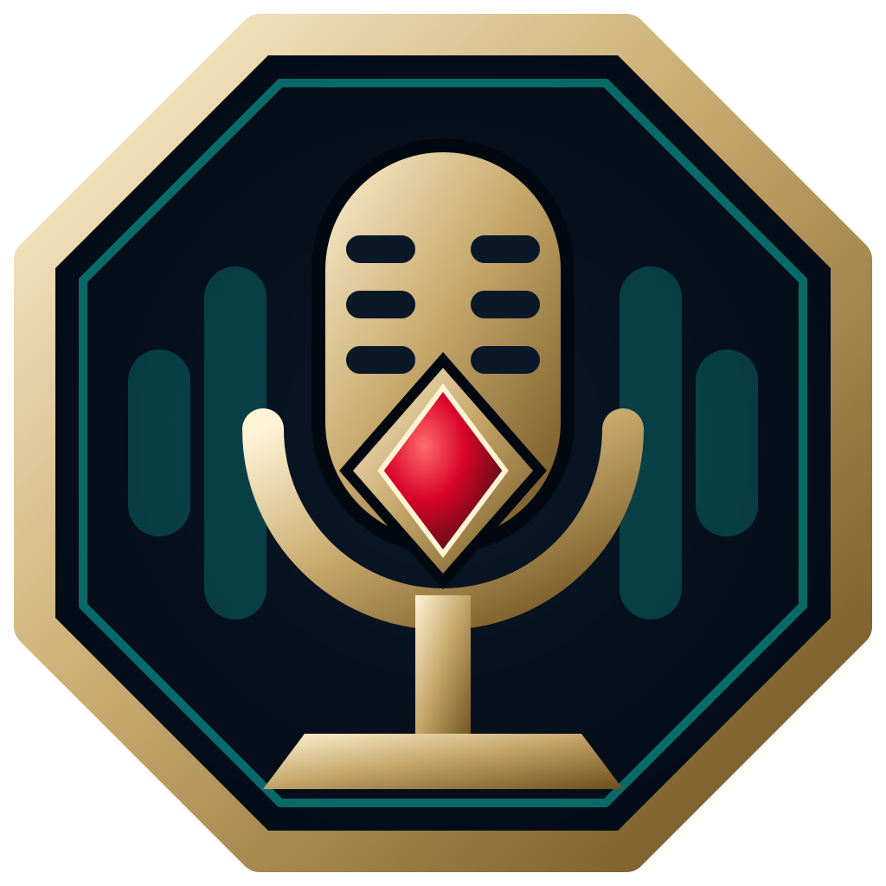
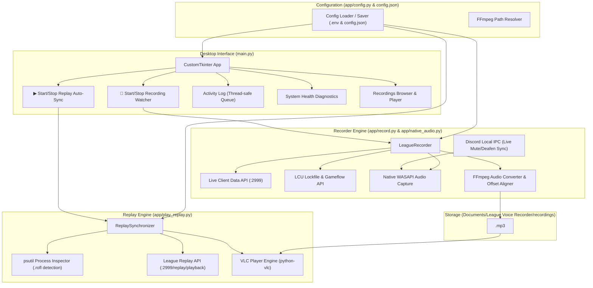

# League Voice Recorder & Replay Synchronizer

<p align="center">
  
</p>

<p align="center">
  <a href="https://github.com/betterix/league-voice-recorder/releases"></a>
  
  
  
  
  
  <a href="LICENSE"></a>
  <a href="SECURITY.md"></a>
</p>

<p align="center">
  <strong>Zero-Latency Automated Scrim Comms Recording &amp; Frame-Accurate Replay Audio Synchronization for League of Legends.</strong>
</p>

<p align="center">
  <a href="#-key-features">Features</a> &bull;
  <a href="#-quick-start-tutorial">Quick Start Tutorial</a> &bull;
  <a href="#-system-architecture">Architecture</a> &bull;
  <a href="#-community-translations-i18n">Community Translations</a> &bull;
  <a href="#-development--testing">Development</a>
</p>

---

## 📌 The Problem & The Solution

In competitive League of Legends scrimmages and tournament matches, reviewing gameplay alongside synchronized team voice communications is critical for player improvement. However, teams constantly run into the same friction points:

1. **Recording Friction**: Players forget to hit record, Discord voice isn't separated from desktop game audio, or recording starts seconds late after minions spawn, throwing voice timing completely out of sync with the game clock.
2. **Review Friction**: When watching `.rofl` match replays in the League client, syncing an external audio recording manually is tedious. Fast-forwarding (2x, 4x), rewinding, or pausing instantly desynchronizes the audio from the gameplay.

**League Voice Recorder solves both ends of this workflow automatically:**

- 🔴 **Live Scrim Watcher**: Connects to the local League Client API. When a live match begins, it automatically records Discord voice chat and player microphone with zero latency (<1ms). It tracks pauses, extracts the official Riot Game ID, aligns the audio frame-by-frame with game time (`00:00:00`), and exports a compressed `<GameID>.mp3`.
- ▶ **Replay Auto-Sync**: When you open any `.rofl` replay file in the League client, it detects the process, extracts the Game ID, loads `<GameID>.mp3` into VLC, and locks playback to the League replay clock. Scrubbing, pausing, rewinding, or changing speed (0.5x, 1x, 2x, 4x) keeps voice comms perfectly synchronized in real time.

---

## ✨ Key Features

- ⚡ **Zero-Latency Match Start**: Attaches instantly to Discord and mic. When your game launches, recording starts in under 1 millisecond.
- 🔇 **Discord Live Mute & Deafen Sync**: Real-time integration via Discord Local IPC (`\\.\pipe\discord-ipc-*`). When you mute or deafen in Discord (or via hotkey), the app automatically injects silence into the recording while preserving sample-accurate timeline alignment.
- ⏹️ **Hands-Free Match Auto-Stop**: When the nexus explodes or the match ends, the watcher automatically finalizes your `<GameID>.mp3` and stops listening without requiring manual button clicks.
- 🎯 **Sample-Accurate Audio Alignment**:
  - If recording begins after 00:00, exact silence is prepended via FFmpeg (`adelay`).
  - If recording begins before 00:00 during countdown, the pre-game buffer is trimmed (`-ss`).
  - Result: `00:00:00` in the exported MP3 matches game time `0.000` frame-by-frame.
- 🛡️ **Replay Guard**: Inspects running processes to prevent live recording when you are merely inspecting or reviewing `.rofl` replays.
- 🎙️ **Direct WASAPI Audio Capture**: Automatically captures team Discord voice chat (via WASAPI loopback) along with player microphone directly in Windows.
- ⏩ **Real-Time Replay Speed & Position Sync**: Continuously polls the League Replay API (`:2999/replay/playback`) to synchronize playback speed (0.5x to 8x), pauses, and seeks.
- 🔊 **Dynamic Replay Volume & Mute Hotkey**: Adjust replay voice volume (0–100%) on the fly, or press **`M`** (both inside League replay observer mode and in the desktop app) to instantly mute/unmute the replay voice track.
- 🌐 **Extensible Internationalization (i18n)**: English (default) and Hungarian built-in. Community translations are purely drop-in JSON files—no Python code modifications required.
- 🩺 **Real-Time System Health Diagnostics**: Instant status badges for Discord voice capture, League Client process, 64-bit VLC engine, and FFmpeg binary.
- 📂 **Integrated Scrim Manager**: In-app browser displaying recorded scrims, file sizes, creation dates, and instant "Play in VLC" or "Open in Explorer" buttons.

---

## 🏛 System Architecture



---

## 📋 Prerequisites

Install the required dependencies via Windows Package Manager (`winget`):

```powershell
# 1. FFmpeg (Audio conversion & alignment)
winget install -e --id Gyan.FFmpeg

# 2. VLC Media Player 64-bit (Replay synchronization)
winget install -e --id VideoLAN.VLC
```

### ⚙️ Enable League of Legends Replay API (Required for Replay Sync)

> [!IMPORTANT]
> **Enable the Replay API before starting**:
> By default, the League of Legends Replay API is disabled. To start using the Replay API for automatic audio synchronization, enable the Replay API in the game client configuration by locating where your game is installed and adding the following lines to your `game.cfg` file:
>
> **Example file location:**
> `C:\Riot Games\League of Legends\Config\game.cfg`
>
> **Configuration setting to add:**
> ```ini
> [General]
> EnableReplayApi=1
> ```
> *Note: If `[General]` already exists in `game.cfg`, simply add `EnableReplayApi=1` directly under it, then save the file.*

### 🛡️ Discord Local IPC & Safe One-Time Authorization

> [!NOTE]
> **Is Discord IPC safe? Yes, 100%!**
> - **Zero Third-Party Drivers**: Does not install virtual audio cables, audio drivers, or injected DLLs.
> - **How it connects**: Connects locally through Windows' secure local named pipe (`\\.\pipe\discord-ipc-*`) directly to your running Discord desktop client using Discord's official first-party **StreamKit Overlay RPC** client ID (`207646673902501888`).
> - **What it does**: It only monitors your voice status (`mute` and `deaf` states). When you mute yourself in Discord or via your mouse/keyboard hotkey, the app automatically feeds synchronized silence bytes into the microphone stream. This ensures private team comms or callouts stay muted in recordings while keeping the audio track in 100% sample-accurate alignment with match time.
> - **One-time authorization prompt**: On your very first run, Discord will display a popup:
>   > *"StreamKit Overlay wants to access your Discord account: Access your voice settings."*
>   
>   **Do not be afraid or alarmed!** Simply click **Authorize**. The application securely saves the authorized token in `config.json`. **Discord will remember your decision and will NEVER ask you again.** All subsequent launches authenticate silently in under 50 milliseconds.

---

## 🚀 Quick Start Tutorial

### Method 1: Download Standalone Release (Recommended)

1. Go to the [Releases](https://github.com/betterix/league-voice-recorder/releases) page.
2. Download `LeagueVoiceRecorder-Windows-x64.zip`.
3. Extract the `.zip` archive to any directory on your computer.
4. Double-click `LeagueVoiceRecorder.exe` to launch the application.

---

### Step-by-Step Setup & Usage Guide

#### Step 1: Initial Health Check & Recording

1. Launch the application:
   ```powershell
   uv run main.py
   ```
2. Verify the **System Health** diagnostics in the top banner.
3. Click **Start Recording Watcher**.

#### Step 2: Automated Scrim Recording
1. Before starting your scrim, click **🔴 Start Recording Watcher**.
   - The status pill will change to `LISTENING: Waiting for match...`
2. Open Discord and League of Legends.
3. Start your match normally.
4. **Hands-free Automation**:
   - As soon as the game loads, the status updates to `RECORDING: Live Match (MM:SS)`.
   - If the game pauses, recording automatically pauses.
   - When the nexus explodes or the game exits, the app automatically fetches the official Riot Game ID, aligns the audio to `00:00:00`, saves `<GameID>.mp3` into your recordings folder, and automatically stops listening.

---

#### Step 3: Automated Replay Audio Synchronization
1. When reviewing the match with your team, click **▶ Start Replay Auto-Sync**.
   - The status pill will change to `WATCHING: Waiting for replay...`
2. Open your League Client, navigate to **Profile** ➔ **Match History**, and click the **Download Replay** and **Play Replay** button for the scrim match (or double-click any downloaded `.rofl` file).
3. **Instant Synchronization**:
   - The application detects the active `.rofl` replay file and reads the match Game ID.
   - It locates the matching `<GameID>.mp3` and immediately begins synchronized playback in VLC.
   - Use the **Replay Volume Slider** in the UI to balance team voice comms against game sound, or press **`M`** to toggle mute/unmute directly.
   - Fast-forward (2x, 4x), rewind, or pause in the League replay—the voice track stays locked frame-by-frame with the gameplay.

> [!TIP]
> Ensure you have added `EnableReplayApi=1` to your `game.cfg` as described in [Prerequisites](#-prerequisites) so the League client exposes the replay playback API on port `2999`.

---

## 🌐 Community Translations (i18n)

League Voice Recorder features a dynamic internationalization system. Anyone can add a new language without writing any Python code:

1. Navigate to the `locales/` folder.
2. Copy `en.json` and rename it to your ISO 639-1 language code (e.g., `de.json`, `es.json`, `fr.json`, `ko.json`).
3. Set the `"__language_name__"` field at the top to your language's native name:
   ```json
   {
     "__language_name__": "Deutsch",
     "app": {
       "title": "League Voice Recorder",
       ...
     }
   }
   ```
4. Translate the strings in your new JSON file.
5. Launch the application, open **Settings**, and select your language from the **Interface Language** dropdown. All UI text, tabs, buttons, and logs will update in real-time!

> [!TIP]
> If any translation key is missing in your translation file, the app automatically falls back to English seamlessly.

---

## 🛠 Development & Testing

### Running from Source

```powershell
# 1. Clone the repository
git clone https://github.com/betterix/league-voice-recorder.git
cd "League-Voice-Recorder"

# 2. Install dependencies with uv
uv sync --dev

# 3. Launch the desktop GUI
.\scripts\start_ui.bat
# Or directly via uv:
uv run main.py

# 4. Run standalone engines without GUI (CLI mode)
uv run python -m app.record
uv run python -m app.play_replay
```

### Running the Automated Test Suite

The project includes an automated test suite with 49 unit tests covering configuration, Discord Local IPC mute/deafen synchronization, internationalization, sample-accurate recorder alignment, replay parsing and hotkey mute, and headless UI rendering:

```powershell
# Run tests with the Windows launcher script
.\scripts\run_tests.bat

# Or run tests directly with uv
uv run python -m unittest discover tests -v

# Run the Ruff linter
uvx ruff check .
```

### Compiling Standalone `.EXE` Locally

```powershell
# Build standalone distribution in dist/LeagueVoiceRecorder/
.\scripts\build_exe.bat
```

---

## 📦 GitHub Actions Automated Release Pipeline

Every time a new GitHub Release is published or a tag matching `v*` (e.g., `v1.0.0`) is pushed, the [GitHub Actions Workflow](.github/workflows/release.yml) automatically:

1. Spins up a clean `windows-latest` virtual environment.
2. Installs Python 3.14.10 and dependencies via `uv`.
3. Provisions VLC Media Player and runs the complete 42-test suite.
4. Compiles the standalone distribution with Nuitka in standalone mode.
5. Bundles `LeagueVoiceRecorder.exe` (automatically creates `config.json` on first run).
6. Packages and uploads `LeagueVoiceRecorder-Windows-x64.zip` directly to the GitHub Release.

---

## 📂 Project Structure

```text
League Voice Recorder/
│
├── main.py                 # Primary Desktop GUI application entrypoint
│
├── app/                    # Application package
│   ├── __init__.py         # Package marker
│   ├── config.py           # Configuration loader, saver, and path resolver
│   ├── discord_ipc.py      # Discord Local IPC client (live mute/deafen tracking)
│   ├── i18n.py             # Internationalization and community translation loader
│   ├── record.py           # LeagueRecorder engine (WASAPI capture & FFmpeg alignment)
│   ├── native_audio.py     # Native WASAPI audio capture (Discord loopback & mic)
│   └── play_replay.py      # ReplaySynchronizer engine (process watcher & VLC sync)
│
├── assets/                 # Visual branding assets (icons, logos)
│   ├── icon.ico            # Windows executable multi-resolution icon
│   ├── icon.png            # PNG logo graphic
│   └── icon.svg            # Scalable vector logo
│
├── locales/                # Community & built-in i18n translation JSON files
│   ├── en.json             # English (default fallback)
│   └── hu.json             # Hungarian
│
├── scripts/                # Windows automation & build scripts
│   ├── start_ui.bat        # Windows quick-launcher for the GUI
│   ├── run_tests.bat       # Automated test suite runner batch script
│   └── build_exe.bat       # Standalone Windows .exe compiler batch script
│
├── tests/                  # Automated test suite (49 unit tests)
│   ├── __init__.py
│   ├── test_config.py      # Config defaults, path resolution, and directory creation
│   ├── test_discord_ipc.py # Discord Local IPC & mute silence injection
│   ├── test_i18n.py        # Locale discovery, translation lookup, and key parity
│   ├── test_recorder.py    # FFmpeg sample-accurate offset alignment & replay guard
│   ├── test_replay_sync.py # ROFL Game ID extraction & volume clamping
│   └── test_ui.py          # CustomTkinter headless UI & live language switching
│
├── .github/
│   └── workflows/
│       ├── codeflash.yaml  # Codeflash AI performance optimization workflow
│       └── release.yml     # Automated GitHub Actions release compilation
│
├── .gitattributes          # Cross-platform LF/CRLF normalization
├── .env.example            # Environment variables template
├── SECURITY.md             # Security policy & private vulnerability reporting
├── pyproject.toml          # Project dependencies and tool configurations
├── ruff.toml               # Linter rules and exclusions
└── requirements.txt        # Frozen dependencies export
```

---

## 🚀 What's New in v0.3.1

- 🎙️ **Microphone Input Selector (UI & Settings)**:
  - Added dedicated Microphone Input selector dropdown directly on the Scrim Recorder card and in the Settings tab.
  - Automatically discovers all available physical audio inputs (prioritizing high-resolution WASAPI devices) along with Windows Default Microphone.
  - Dynamically updates live VU meters and switches active recording hardware instantly without needing app restart.
  - Persists selected microphone device name and index across sessions in `config.json`.
- 📊 **Calibrated Responsive Audio VU Visualizers**:
  - Fine-tuned VU meter curve and noise floor thresholds for smooth, natural audio visualization.
  - Prevents idle jitter at rest while actively tracking team Discord comms and microphone levels.
- 🎛️ **Transparent Natural Audio Mixing**:
  - Clean, uncolored 48kHz stereo alignment with transparent gain staging and true-peak limiting (`alimiter=limit=0.95`).
- ⚡ **Timeline Alignment & Sample Stability**:
  - Sample-accurate alignment with League of Legends match time (`00:00:00`) with ultra-fast pause and unpause handling.

---

## 🚀 What's New in v0.3.0

- 🎧 **Pure Discord Process Isolation (`proc-tap`)**:
  - Directly hooks into Discord via Windows WASAPI Process Loopback (`proc-tap`).
  - Ignores game sounds, browser, and background noise — capturing 100% isolated Discord team voice chat.
- 🎙️ **Native Microphone Capture via PyAudioWPatch**:
  - Replaced legacy audio packages with lightweight `PyAudioWPatch`.
  - Process-wide thread-safe PortAudio singleton preventing concurrent initialization crashes.
- ⏱️ **Continuous Clock Synchronization & Zero Drift**:
  - Hardware-clock-aligned silence injection writes exact 48kHz silence frames during Discord quiet intervals, eliminating audio drift over 30+ minute matches.
- ⏸️ **Instant Match Pause Detection & Exact Detection Window Purge**:
  - Detects match pauses in ~140ms (7 polls @ 20ms) instead of legacy 1.5s delay.
  - Automatically purges the 140ms detection staging buffer when pause triggers, ensuring 0ms of pause audio is written to disk and eliminating post-pause replay desync.
- 📦 **Automated Build & CI Dependency Synchronization**:
  - Build script and GitHub Actions release workflow automatically synchronize and bundle all required packages (`proctap`, `pyaudiowpatch`, `pycaw`).

---

## 🚀 What's New in v0.2.5

- ⚡ **Massive Performance & Instant Shutdown Overhaul**:
  - Optimized process inspection across all watchers using initial PID/name filtering before querying command lines (scanning latency reduced from ~1,040ms down to ~1.05ms per tick).
  - Audio session COM meter cached in idle monitor loops (315x speedup; CPU reduced to <0.1%).
  - Fast instant window hide (`self.withdraw()`) and non-blocking exit (`os._exit(0)`) eliminating exit delays.
  - Automated test suite execution time reduced from ~19s to ~8s.
- 🎯 **Hands-Free Champion Select Auto-Start**:
  - Connects to Riot's local LCU Gameflow API (`/lol-gameflow/v1/gameflow-phase`). When entering Champion Select (`ChampSelect`), the Recording Watcher automatically starts listening without requiring manual button clicks.
  - Fully configurable via the `Auto-Start in Champ Select` switch in the Settings tab.
- 🎬 **Hands-Free Replay Auto-Detection**:
  - Monitors for launched `.rofl` replay processes. When a replay match begins in League, the Replay Auto-Sync watcher automatically activates and locks audio playback.
  - When the replay is closed in the League client, playback stops cleanly and resets the UI button automatically.
  - Fully configurable via the `Auto-Start Replay Sync` switch in the Settings tab.
- 🔇 **In-Game Replay Mute Hotkey (`M`)**:
  - Press **`M`** inside the League replay spectator mode or desktop app to instantly toggle replay voice comms on and off.
  - Foreground-window guarded and debounced (only responds if League replay or Voice Recorder app is active), preventing accidental muting while typing in Discord or web browsers.
  - Clickable volume badge in the UI displaying `🔇 MUTED (M)` when muted.
- 🧹 **Clean Configuration Storage**:
  - Removed standalone `.discord_token` file; Discord IPC token is now persisted directly inside `config.json` (`discord_ipc_token`) with seamless legacy migration.
- 🐍 **Python 3.14.10 Support**:
  - Upgraded core build scripts, CI/CD GitHub Actions release pipeline, and packaging to Python 3.14.10.

---

## 📄 License

Distributed under the **GNU General Public License v3.0 (GPLv3)**. See [LICENSE](LICENSE) for more information.

---

<div align="center">
Built with ❤️ for competitive League of Legends teams, coaches, and players.
</div>

