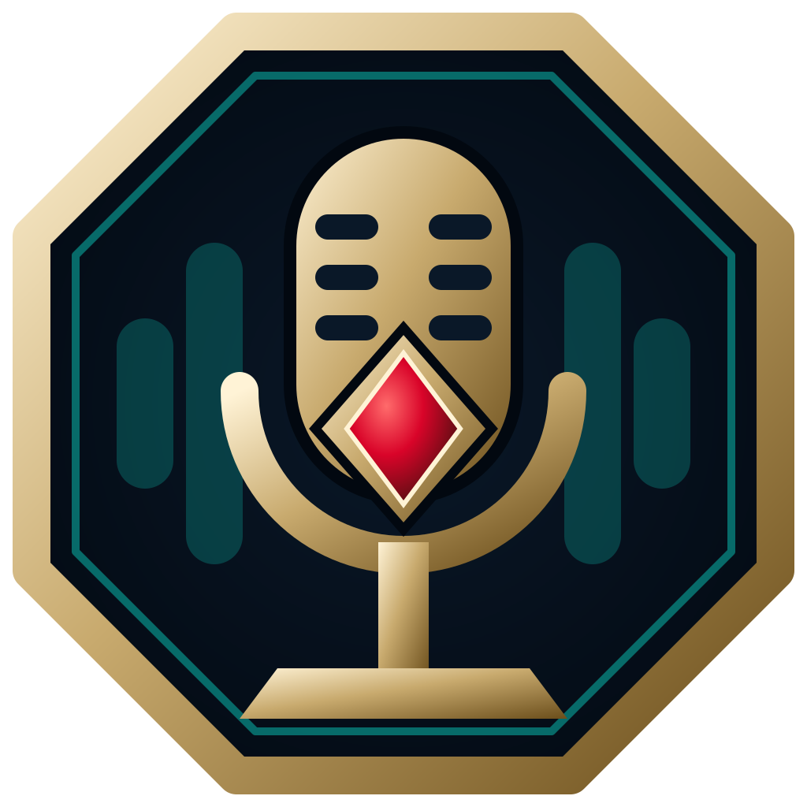

# League Voice Recorder

<p align="center">
  
</p>

<p align="center">
  <strong>Zero-latency automated scrim voice recording & frame-accurate replay audio synchronization for League of Legends.</strong>
</p>

<p align="center">
  <a href="https://github.com/betterix/league-voice-recorder/actions/workflows/codeql.yml"></a>
  
  
  
  
  
</p>

---

## ⚡ Overview

**League Voice Recorder** is a native Windows desktop application built with **Rust** and **Tauri v2**. It automates team voice recording and replay audio synchronization for competitive League of Legends scrimmages and reviews:

1. **🔴 Hands-Free Scrim Recording**: Connects to the local League Client and Discord IPC. When a match starts, it automatically captures team Discord voice chat and the player's microphone via native Windows WASAPI loopback, accounts for in-game pauses, extracts the official Riot Game ID, and streams directly to disk with sample-accurate alignment.
2. **▶ Frame-Accurate Replay Synchronization**: When opening any `.rofl` replay file in the League client, it detects the process, loads `<GameID>.mp3`, and locks playback to the League replay clock. Scrubbing, pausing, rewinding, or changing speed (0.5x – 4x) keeps voice comms perfectly synchronized in real time.
3. **🪟 In-Game Floating HUD Overlay**: A transparent, click-through (`WS_EX_TRANSPARENT`) Hextech HUD overlay displaying live audio waveforms, match clock, and interactive volume controls directly inside the League client window.
4. **☁️ Team Cloud Synchronization**: Seamlessly uploads and downloads scrim recordings to the self-hosted [league-voice-recorder-backend](https://github.com/betterix/league-voice-recorder-backend) with Windows DPAPI encryption and role-based permissions.

---

## 📚 Documentation

Detailed architectural and operational documentation is available in the [`docs/`](docs/) directory:

- [**System Architecture**](docs/architecture.md) — High-level overview, zero-RAM streaming pipeline, and tech stack.
- [**Scrim Recording Engine**](docs/recording.md) — Zero-latency match start, sample-accurate alignment, and pause lag truncation.
- [**Replay Synchronization Engine**](docs/replay_sync.md) — Replay process detection, Game ID extraction, and Rodio audio playback sync.
- [**In-Game Floating HUD Overlay**](docs/overlay.md) — Dual HUD modes, GradeX harmonics, native dragging, and click-through mechanics.
- [**Remote Scrim Cloud Sync**](docs/cloud_sync.md) — Rust/Axum backend integration, DPAPI key encryption, and RBAC permissions.
- [**System Tray & Background Notifications**](docs/system_tray.md) — Minimization behavior, dynamic tooltip, and native alert sounds.
- [**Configuration & Storage**](docs/configuration.md) — `config.json` schema, directory hierarchy, and audio device discovery.
- [**IPC & Command Reference**](docs/api_reference.md) — Type-safe Tauri IPC commands and DTO payloads.

---

## 🚀 Quick Start

### Standalone Executable & Installer
1. Download the latest `LeagueVoiceRecorder.exe` or `LeagueVoiceRecorder_0.6.3_x64-setup.exe` from [Releases](https://github.com/betterix/league-voice-recorder/releases).
2. Launch the application or install via setup wizard. Both the **Recording Watcher** and **Replay Auto-Sync** start automatically in hands-free mode.
3. Minimize to system tray; the app will monitor matches quietly in the background.

### Building from Source

**Requirements:**
- Windows 10 or 11 (64-bit)
- [Rust](https://rustup.rs/) (1.78+)
- [Node.js](https://nodejs.org/) (v18+)
- [NSIS](https://nsis.sourceforge.io/) (optional, for building the Windows installer)

```bash
# Clone the repository
git clone https://github.com/betterix/league-voice-recorder.git
cd league-voice-recorder

# Run in development mode
cargo tauri dev

# Compile standalone release executable
cargo build --release

# (Optional) Build NSIS Setup Wizard installer
makensis installer.nsi
```

---

## 🛡️ Vanguard & Competitive Safety

League Voice Recorder is **100% compliant and safe** with Riot Vanguard:
- **No Memory Reading / Injection**: Never hooks, touches, or scans game memory.
- **No Virtual Drivers**: Audio capture relies solely on native Windows WASAPI loopback.
- **Official APIs Only**: Reads exclusively from Riot's approved local HTTP endpoints:
  - Live Client Data API (`https://127.0.0.1:2999/liveclientdata/allgamedata`)
  - Replay Playback API (`https://127.0.0.1:2999/replay/playback`)
  - League Client Update (LCU) Gameflow API

---

## 🤝 Companion Projects

- **[league-voice-recorder-backend](https://github.com/betterix/league-voice-recorder-backend)** — High-performance Rust/Axum backend for team scrim aggregation, and role-based scrim distribution.

---

## 📄 License

This project is licensed under the **GNU General Public License v3.0** — see the [LICENSE](LICENSE) file for details.
