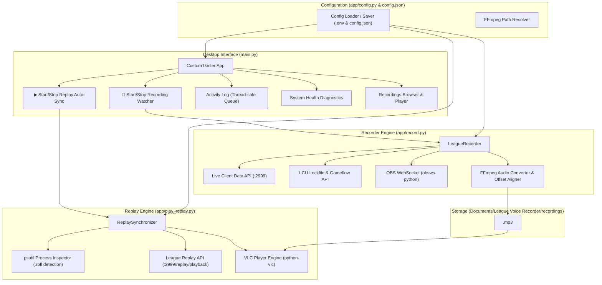

# League Voice Recorder & Replay Synchronizer

<div align="center">


-0078D6?logo=windows&logoColor=white)


**Zero-Latency Automated Scrim Comms Recording & Frame-Accurate Replay Audio Synchronization for League of Legends.**

[Features](#-key-features) • [Quick Start Tutorial](#-quick-start-tutorial) • [Architecture](#-system-architecture) • [Community Translations](#-community-translations-i18n) • [Development](#-development--testing)

---

</div>

## 📌 The Problem & The Solution

In competitive League of Legends scrimmages and tournament matches, reviewing gameplay alongside synchronized team voice communications is critical for player improvement. However, teams constantly run into the same friction points:

1. **Recording Friction**: Players forget to hit record, Discord voice isn't separated from desktop game audio, or recording starts seconds late after minions spawn, throwing voice timing completely out of sync with the game clock.
2. **Review Friction**: When watching `.rofl` match replays in the League client, syncing an external audio recording manually is tedious. Fast-forwarding (2x, 4x), rewinding, or pausing instantly desynchronizes the audio from the gameplay.

**League Voice Recorder solves both ends of this workflow automatically:**

- 🔴 **Live Scrim Watcher**: Connects to the local League Client API and OBS Studio. When a live match begins, it switches OBS to a designated voice-only scene (`"Discord Only"`) and triggers recording with **zero latency** (<10ms). It tracks pauses, extracts the official Riot Game ID, aligns the audio frame-by-frame with game time (`00:00:00`), and exports a compressed `<GameID>.mp3`.
- ▶ **Replay Auto-Sync**: When you open any `.rofl` replay file in the League client, it detects the process, extracts the Game ID, loads `<GameID>.mp3` into VLC, and locks playback to the League replay clock. Scrubbing, pausing, rewinding, or changing speed (0.5x, 1x, 2x, 4x) keeps voice comms perfectly synchronized in real time.

---

## ✨ Key Features

- ⚡ **Zero-Latency Match Start**: Pre-configures OBS scenes and audio sources on connection. When your game launches, recording starts in under 10 milliseconds.
- 🎯 **Sample-Accurate Audio Alignment**:
  - If recording begins after 00:00, exact silence is prepended via FFmpeg (`adelay`).
  - If recording begins before 00:00 during countdown, the pre-game buffer is trimmed (`-ss`).
  - Result: `00:00:00` in the exported MP3 matches game time `0.000` frame-by-frame.
- 🛡️ **Replay Guard**: Inspects running processes to prevent live recording when you are merely inspecting or reviewing `.rofl` replays.
- 🎙️ **Automated OBS Scene Management**: One-click auto-setup creates the `"Discord Only"` scene in OBS, isolates Discord audio capture with window matching priority (`"Window title must match"` / `"Az ablak címének egyeznie kell"`), adds the player's microphone, and mutes desktop clutter.
- ⏩ **Real-Time Replay Speed & Position Sync**: Continuously polls the League Replay API (`:2999/replay/playback`) to synchronize playback speed (0.5x to 8x), pauses, and seeks.
- 🔊 **Dynamic Replay Volume Slider**: Adjust replay voice volume (0–100%) on the fly with live libvlc volume updates and persistent configuration saving.
- 🌐 **Extensible Internationalization (i18n)**: English (default) and Hungarian built-in. Community translations are purely drop-in JSON files—no Python code modifications required.
- 🩺 **Real-Time System Health Diagnostics**: Instant status badges for OBS WebSocket, League Client process, 64-bit VLC engine, and FFmpeg binary.
- 📂 **Integrated Scrim Manager**: In-app browser displaying recorded scrims, file sizes, creation dates, and instant "Play in VLC" or "Open in Explorer" buttons.

---

## 🏛 System Architecture



---

## 📋 Prerequisites

Before running the application, make sure the following dependencies are installed on your Windows system:

1. **[OBS Studio](https://obsproject.com/)** (v28.0 or newer)
   - Enable WebSocket: In OBS, go to **Tools** ➔ **WebSocket Server Settings** ➔ check **Enable WebSocket server**.
   - Note down the Server Port (default: `4455`) and Server Password.
2. **[League of Legends](https://leagueoflegends.com/)** (Installed and running on your system).
3. **[VLC Media Player (64-bit)](https://www.videolan.org/vlc/)**
   - > [!IMPORTANT]
     > You **must** install the **64-bit** version of VLC (`C:\Program Files\VideoLAN\VLC`), as 32-bit VLC cannot be loaded by 64-bit Python/runtime processes.
4. **FFmpeg** (Included automatically with releases and in the project repository).

---

## 🚀 Quick Start Tutorial

### Method 1: Download Standalone Release (Recommended)

1. Go to the [Releases](https://github.com/your-username/League-Voice-Recorder/releases) page.
2. Download `LeagueVoiceRecorder-Windows-x64.zip`.
3. Extract the `.zip` archive to any directory on your computer.
4. Double-click `LeagueVoiceRecorder.exe` to launch the application.

---

### Step-by-Step Setup & Usage Guide

#### Step 1: Initial Health Check & OBS Connection
1. Launch **League Voice Recorder**.
2. Look at the top **System Diagnostics Bar**:
   - `OBS`: Green indicates connected; Grey/Red indicates offline.
   - `League`: Shows whether the League Client is running.
   - `VLC`: Shows whether the 64-bit VLC engine is installed and ready.
   - `FFmpeg`: Shows whether the audio encoder is available.
3. Open the **Settings** tab:
   - Enter your **OBS WebSocket Port** (`4455`) and **Password**.
   - Click **Test OBS Connection** to verify.
   - Click **Auto-Setup OBS Scene**. The application will automatically create the `"Discord Only"` scene in your OBS, add your microphone, add Discord audio capture with correct window matching priority, and mute desktop noise.
   - Click **Save Settings**.

---

#### Step 2: Automated Scrim Recording
1. Before starting your scrim, click **🔴 Start Recording Watcher**.
   - The status pill will change to `LISTENING: Waiting for match...`
2. Open Discord and League of Legends.
3. Start your match normally.
4. **Hands-free Automation**:
   - As soon as the game loads, the status updates to `RECORDING: Live Match (MM:SS)`.
   - If the game pauses, OBS recording automatically pauses.
   - When the nexus explodes or the game exits, the app automatically fetches the official Riot Game ID, aligns the audio to `00:00:00`, and saves `<GameID>.mp3` into your recordings folder.

---

#### Step 3: Automated Replay Audio Synchronization
1. When reviewing the match with your team, click **▶ Start Replay Auto-Sync**.
   - The status pill will change to `WATCHING: Waiting for replay...`
2. Open your League Client, navigate to **Profile** ➔ **Match History**, and click the **Download Replay** and **Play Replay** button for the scrim match (or double-click any downloaded `.rofl` file).
3. **Instant Synchronization**:
   - The application detects the active `.rofl` replay file and reads the match Game ID.
   - It locates the matching `<GameID>.mp3` and immediately begins synchronized playback in VLC.
   - Use the **Replay Volume Slider** in the UI to balance team voice comms against game sound.
   - Fast-forward (2x, 4x), rewind, or pause in the League replay—the voice track stays locked frame-by-frame with the gameplay.

---

## 🌐 Community Translations (i18n)

League Voice Recorder features a dynamic internationalization system. Anyone can add a new language without writing any Python code:

1. Navigate to the `locales/` folder.
2. Copy `en.json` and rename it to your ISO 639-1 language code (e.g., `de.json`, `es.json`, `fr.json`, `ko.json`).
3. Set the `"__language_name__"` field at the top to your language's native name:
   ```json
   {
     "__language_name__": "Deutsch",
     "app": {
       "title": "League Voice Recorder",
       ...
     }
   }
   ```
4. Translate the strings in your new JSON file.
5. Launch the application, open **Settings**, and select your language from the **Interface Language** dropdown. All UI text, tabs, buttons, and logs will update in real-time!

> [!TIP]
> If any translation key is missing in your translation file, the app automatically falls back to English seamlessly.

---

## 🛠 Development & Testing

### Running from Source

```powershell
# 1. Clone the repository
git clone https://github.com/your-username/League-Voice-Recorder.git
cd "League-Voice-Recorder"

# 2. Install dependencies with uv
uv sync --dev

# 3. Launch the desktop GUI
.\start_ui.bat
# Or directly via uv:
uv run main.py

# 4. Run standalone engines without GUI (CLI mode)
uv run python -m app.record
uv run python -m app.play_replay
```

### Running the Automated Test Suite

The project includes an automated test suite with 26 unit tests covering configuration, internationalization, sample-accurate recorder alignment, replay parsing, and headless UI rendering:

```powershell
# Run tests with the Windows launcher script
.\run_tests.bat

# Or run tests directly with uv
uv run python -m unittest discover tests -v

# Run the Ruff linter
uvx ruff check .
```

### Compiling Standalone `.EXE` Locally

```powershell
# Build standalone distribution in dist/LeagueVoiceRecorder/
.\build_exe.bat
```

---

## 📦 GitHub Actions Automated Release Pipeline

Every time a new GitHub Release is published or a tag matching `v*` (e.g., `v1.0.0`) is pushed, the [GitHub Actions Workflow](.github/workflows/release.yml) automatically:

1. Spins up a clean `windows-latest` virtual environment.
2. Installs Python 3.16 and dependencies via `uv`.
3. Runs the complete 26-test suite to verify integrity.
4. Compiles the standalone executable with PyInstaller.
5. Bundles `LeagueVoiceRecorder.exe`, `ffmpeg.exe`, `locales/`, `.env.example`, and `README.md`.
6. Packages and uploads `LeagueVoiceRecorder-Windows-x64.zip` directly to the GitHub Release.

---

## 📂 Project Structure

```text
League Voice Recorder/
│
├── main.py                 # Primary Desktop GUI application entrypoint
├── start_ui.bat            # Windows quick-launcher for the GUI
├── run_tests.bat           # Automated test suite runner batch script
├── build_exe.bat           # Standalone Windows .exe compiler batch script
│
├── app/                    # Application package
│   ├── __init__.py         # Package marker
│   ├── config.py           # Configuration loader, saver, and path resolver
│   ├── i18n.py             # Internationalization and community translation loader
│   ├── record.py           # LeagueRecorder engine (OBS automation & FFmpeg alignment)
│   └── play_replay.py      # ReplaySynchronizer engine (process watcher & VLC sync)
│
├── locales/                # Community & built-in i18n translation JSON files
│   ├── en.json             # English (default fallback)
│   └── hu.json             # Hungarian
│
├── tests/                  # Automated test suite (26 unit tests)
│   ├── __init__.py
│   ├── test_config.py      # Config defaults, path resolution, and directory creation
│   ├── test_i18n.py        # Locale discovery, translation lookup, and key parity
│   ├── test_recorder.py    # FFmpeg sample-accurate offset alignment & replay guard
│   ├── test_replay_sync.py # ROFL Game ID extraction & volume clamping
│   └── test_ui.py          # CustomTkinter headless UI & live language switching
│
├── .github/
│   └── workflows/
│       └── release.yml     # Automated GitHub Actions release compilation
│
├── .env.example            # Environment variables template
├── pyproject.toml          # Project dependencies and tool configurations
├── ruff.toml               # Linter rules and exclusions
└── requirements.txt        # Frozen dependencies export
```

---

## 📄 License

Distributed under the **MIT License**. See `LICENSE` for more information.

---

<div align="center">
Built with ❤️ for competitive League of Legends teams, coaches, and players.
</div>
