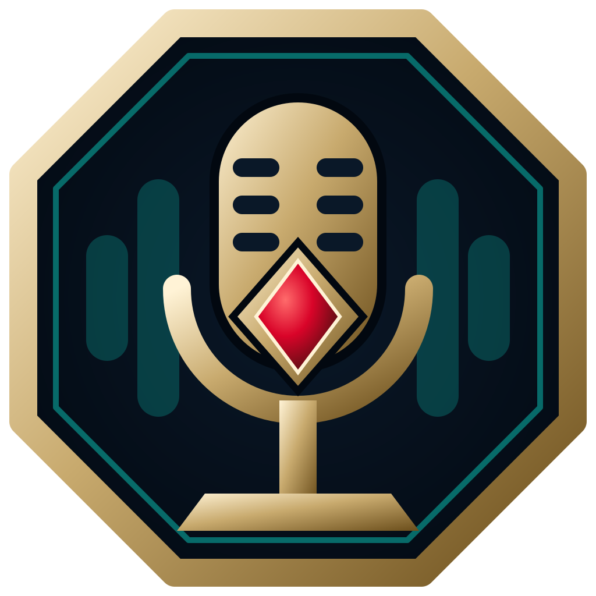
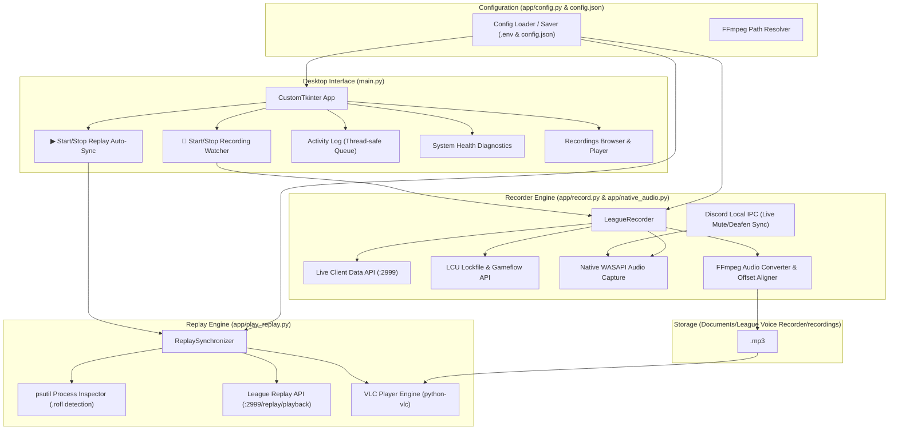

# League Voice Recorder & Replay Synchronizer

<p align="center">
  
</p>

<p align="center">
  <a href="https://betterix.github.io/league-voice-recorder/"></a>
  <a href="https://github.com/betterix/league-voice-recorder/releases"></a>
  
  
  
  
  
  <a href="LICENSE"></a>
  <a href="SECURITY.md"></a>
  <a href="CODE_OF_CONDUCT.md"></a>
  <a href="CONTRIBUTING.md"></a>
</p>

<p align="center">
  <strong>Zero-Latency Automated Scrim Comms Recording &amp; Frame-Accurate Replay Audio Synchronization for League of Legends.</strong>
</p>

<p align="center">
  <a href="https://betterix.github.io/league-voice-recorder/"><strong>🌐 Live Web Showcase &amp; Simulator</strong></a> &bull;
  <a href="#-key-features">Features</a> &bull;
  <a href="#-quick-start-tutorial">Quick Start Tutorial</a> &bull;
  <a href="#-system-architecture">Architecture</a> &bull;
  <a href="#-community-translations-i18n">Community Translations</a> &bull;
  <a href="#-development--testing">Development</a>
</p>

---

## 📌 The Problem & The Solution

In competitive League of Legends scrimmages and tournament matches, reviewing gameplay alongside synchronized team voice communications is critical for player improvement. However, teams constantly run into the same friction points:

1. **Recording Friction**: Players forget to hit record, Discord voice isn't separated from desktop game audio, or recording starts seconds late after minions spawn, throwing voice timing completely out of sync with the game clock.
2. **Review Friction**: When watching `.rofl` match replays in the League client, syncing an external audio recording manually is tedious. Fast-forwarding (2x, 4x), rewinding, or pausing instantly desynchronizes the audio from the gameplay.

**League Voice Recorder solves both ends of this workflow automatically:**

- 🔴 **Live Scrim Watcher**: Connects to the local League Client API. When a live match begins, it automatically records Discord voice chat and player microphone with zero latency (<1ms). It tracks pauses, extracts the official Riot Game ID, aligns the audio frame-by-frame with game time (`00:00:00`), and exports a compressed `<GameID>.mp3`.
- ▶ **Replay Auto-Sync**: When you open any `.rofl` replay file in the League client, it detects the process, extracts the Game ID, loads `<GameID>.mp3` into VLC, and locks playback to the League replay clock. Scrubbing, pausing, rewinding, or changing speed (0.5x, 1x, 2x, 4x) keeps voice comms perfectly synchronized in real time.

---

## ✨ Key Features

### 🎙️ Automated Scrim Voice Recording (Recorder Engine)
- ⚡ **Zero-Latency Match Start**: Connects to the local League Client API (`:2999`). When match load finishes, Native WASAPI capture engages in under 1 millisecond.
- ⏱️ **Sample-Accurate Audio Alignment**:
  - If recording begins after 00:00, exact silence is prepended via FFmpeg (`adelay`).
  - If recording begins before 00:00 during countdown, the pre-game countdown buffer is cleanly trimmed (`-ss`).
  - Result: `00:00:00` in the exported MP3 matches match time `0.000` frame-by-frame.
- ✂️ **Zero-Drift Pause Trimming (WAV Truncation)**: Automatically slices out the ~450ms detection lag when an in-game pause occurs by rewinding and truncating the Discord and microphone WAV streams back to the exact game time of the pause (`truncate_to_game_time`). Eliminates cumulative audio drift across unlimited pauses.
- 🎧 **Pure Discord Process Isolation (`proc-tap`)**: Hooks directly into Discord via Windows WASAPI Process Loopback (`proc-tap`). Captures 100% isolated team voice comms without desktop or game audio bleed.
- 🔇 **Discord Local IPC Live Mute & Deafen Sync**: Real-time integration via Discord Local IPC (`\\.\pipe\discord-ipc-*`). When you mute or deafen in Discord (or via hotkey), the app automatically injects synchronized silence bytes into the recording to preserve timeline alignment without desync.
- 🎤 **Physical Microphone Selection & Calibrated VU Meters**: Dynamic input device selection dropdown (WASAPI devices or Windows Default) with calibrated live VU visualizers.
- ⏹️ **Hands-Free Match Auto-Stop**: When the nexus explodes or the match ends, the watcher automatically finalizes `<GameID>.mp3` and returns to idle without manual button clicks.
- 🛡️ **Replay Guard**: Process tree inspection ensures live recording is never accidentally triggered while reviewing `.rofl` replays.

### ▶️ Intelligent Replay Synchronization (Replay Engine)
- 🎬 **Autonomous .ROFL Detection & Game ID Parsing**: Scans active processes for `League of Legends.exe` replay instances, parses Game ID from filenames (e.g. `EUW1-8018190134.rofl`), and automatically locates the matching `<GameID>.mp3`.
- ⏩ **Continuous Clock & Variable Speed Lock (0.5x – 4x)**: Continuously polls the League Replay API (`:2999/replay/playback`) to synchronize playback speed (0.5x, 1x, 2x, 4x), pauses, and timeline scrubs.
- ⚡ **Zero-Latency Unpause & Debounced Scrubbing**: Instant playback resumption without pipeline-flushing seeks; debounced seek cooldown eliminates VLC asynchronous time flutter.
- 🔇 **In-Game Replay Mute Hotkey (`M`)**: Press **`M`** inside the League replay spectator mode or desktop app to toggle replay voice comms on and off (foreground-window guarded to prevent accidental muting while typing).
- 🔊 **Dynamic Replay Volume Control**: Adjust replay audio level (0–100%) on the fly via UI slider with persistent user preference.

### 🪟 In-Game Floating HUD Overlay (Hextech Esports Overlay)
- 🎮 **Game-Exclusive Display & Anti-Bleed Isolation**:
  - The HUD overlay **ONLY** appears when actively recording a live scrim match (`RECORDING` or `PAUSED`) or synchronizing a replay (`SYNCING` or `PAUSED`) AND the foreground window is the actual League game engine (`League of Legends.exe`).
  - **Client & Desktop Isolation**: 100% hidden when sitting in the League launcher client (`LeagueClientUx.exe`), Discord, browser, or desktop.
  - **Alt-Tab Smart Focus Guard**: Instantly hides when Alt-Tabbing away from `League of Legends.exe`, and immediately restores visibility upon refocusing back into the game.
- 📊 **Dual HUD Modes**:
  - **Live Scrim HUD**: Animated dual-channel oscilloscopes for player mic (`#3DDCC4` mint) and Discord comms (`#8B93FF` periwinkle), pulsing red `REC` indicator, and live digital match clock.
  - **Replay HUD**: Full waveform scrubbing view with white playhead needle (`#FFFFFF`), real-time VLC volume slider, and playback status pill (`▶ REPLAY` / `⏸ PAUSED`).
- 🖱️ **Zero-Interference Draggable Overlay**: Reposition anywhere; coordinates saved in `config.json`. Supports click-through mode (`WS_EX_TRANSPARENT`) so mouse clicks pass straight into League during matches.
- 🖥️ **Centered App Window**: Clean desktop launch geometry automatically centered on the user's primary monitor.

### 📦 Windows Distribution, Packaging & Updates
- 🛠️ **Dual Distribution Options**:
  - **Windows Setup Installer** (`LeagueVoiceRecorder-Setup-*.exe`): 1-click wizard via Inno Setup 6 with per-user installation, desktop & Start Menu shortcuts, and clean uninstaller.
  - **Portable Standalone ZIP** (`LeagueVoiceRecorder-Windows-x64.zip`): Unpack anywhere and run with zero installation.
- 🔄 **High-Performance In-App Auto-Updater**: Instant GitHub Releases checking, 512 KB streaming downloads with buffered disk I/O, parallel `robocopy /MT:8` file replacement, and silent in-place app restart.
- 🌐 **Dynamic Community Internationalization (i18n)**: English and Hungarian built-in; hot-reloadable drop-in JSON translation architecture for instant community contributions.
- 🩺 **Real-Time System Health Diagnostics**: Instant status badges for Discord voice capture, League Client process, 64-bit VLC engine, and FFmpeg binary.
- 📂 **Integrated Scrim Manager**: In-app file manager displaying recorded scrims, file sizes, creation timestamps, and instant "Play in VLC" or "Open in Explorer" buttons.
- 🛡️ **100% Vanguard Safe**: Zero memory injection, zero DLL hooking, zero virtual audio drivers. Uses only Riot's approved local HTTP endpoints and Windows WASAPI APIs.

---

## 🏛 System Architecture



---

## 📋 Prerequisites

Install the required dependencies via Windows Package Manager (`winget`):

```powershell
# 1. FFmpeg (Audio conversion & alignment)
winget install -e --id Gyan.FFmpeg

# 2. VLC Media Player 64-bit (Replay synchronization)
winget install -e --id VideoLAN.VLC
```

### ⚙️ Enable League of Legends Replay API (Required for Replay Sync)

> [!IMPORTANT]
> **Enable the Replay API before starting**:
> By default, the League of Legends Replay API is disabled. To start using the Replay API for automatic audio synchronization, enable the Replay API in the game client configuration by locating where your game is installed and adding the following lines to your `game.cfg` file:
>
> **Example file location:**
> `C:\Riot Games\League of Legends\Config\game.cfg`
>
> **Configuration setting to add:**
> ```ini
> [General]
> EnableReplayApi=1
> ```
> *Note: If `[General]` already exists in `game.cfg`, simply add `EnableReplayApi=1` directly under it, then save the file.*

### 🛡️ Discord Local IPC & Safe One-Time Authorization

> [!NOTE]
> **Is Discord IPC safe? Yes, 100%!**
> - **Zero Third-Party Drivers**: Does not install virtual audio cables, audio drivers, or injected DLLs.
> - **How it connects**: Connects locally through Windows' secure local named pipe (`\\.\pipe\discord-ipc-*`) directly to your running Discord desktop client using Discord's official first-party **StreamKit Overlay RPC** client ID (`207646673902501888`).
> - **What it does**: It only monitors your voice status (`mute` and `deaf` states). When you mute yourself in Discord or via your mouse/keyboard hotkey, the app automatically feeds synchronized silence bytes into the microphone stream. This ensures private team comms or callouts stay muted in recordings while keeping the audio track in 100% sample-accurate alignment with match time.
> - **One-time authorization prompt**: On your very first run, Discord will display a popup:
>   > *"StreamKit Overlay wants to access your Discord account: Access your voice settings."*
>   
>   **Do not be afraid or alarmed!** Simply click **Authorize**. The application securely saves the authorized token in `config.json`. **Discord will remember your decision and will NEVER ask you again.** All subsequent launches authenticate silently in under 50 milliseconds.

---

## 🚀 Quick Start Tutorial

### Method 1: Download Standalone Release (Recommended)

1. Go to the [Releases](https://github.com/betterix/league-voice-recorder/releases) page.
2. Download `LeagueVoiceRecorder-Windows-x64.zip`.
3. Extract the `.zip` archive to any directory on your computer.
4. Double-click `LeagueVoiceRecorder.exe` to launch the application.

---

### Step-by-Step Setup & Usage Guide

#### Step 1: Initial Health Check & Recording

1. Launch the application:
   ```powershell
   uv run main.py
   ```
2. Verify the **System Health** diagnostics in the top banner.
3. Click **Start Recording Watcher**.

#### Step 2: Automated Scrim Recording
1. Before starting your scrim, click **🔴 Start Recording Watcher**.
   - The status pill will change to `LISTENING: Waiting for match...`
2. Open Discord and League of Legends.
3. Start your match normally.
4. **Hands-free Automation**:
   - As soon as the game loads, the status updates to `RECORDING: Live Match (MM:SS)`.
   - If the game pauses, recording automatically pauses.
   - When the nexus explodes or the game exits, the app automatically fetches the official Riot Game ID, aligns the audio to `00:00:00`, saves `<GameID>.mp3` into your recordings folder, and automatically stops listening.

---

#### Step 3: Automated Replay Audio Synchronization
1. When reviewing the match with your team, click **▶ Start Replay Auto-Sync**.
   - The status pill will change to `WATCHING: Waiting for replay...`
2. Open your League Client, navigate to **Profile** ➔ **Match History**, and click the **Download Replay** and **Play Replay** button for the scrim match (or double-click any downloaded `.rofl` file).
3. **Instant Synchronization**:
   - The application detects the active `.rofl` replay file and reads the match Game ID.
   - It locates the matching `<GameID>.mp3` and immediately begins synchronized playback in VLC.
   - Use the **Replay Volume Slider** in the UI to balance team voice comms against game sound, or press **`M`** to toggle mute/unmute directly.
   - Fast-forward (2x, 4x), rewind, or pause in the League replay—the voice track stays locked frame-by-frame with the gameplay.

> [!TIP]
> Ensure you have added `EnableReplayApi=1` to your `game.cfg` as described in [Prerequisites](#-prerequisites) so the League client exposes the replay playback API on port `2999`.

---

## 🌐 Community Translations (i18n)

League Voice Recorder features a dynamic internationalization system. Anyone can add a new language without writing any Python code:

1. Navigate to the `locales/` folder.
2. Copy `en.json` and rename it to your ISO 639-1 language code (e.g., `de.json`, `es.json`, `fr.json`, `ko.json`).
3. Set the `"__language_name__"` field at the top to your language's native name:
   ```json
   {
     "__language_name__": "Deutsch",
     "app": {
       "title": "League Voice Recorder",
       ...
     }
   }
   ```
4. Translate the strings in your new JSON file.
5. Launch the application, open **Settings**, and select your language from the **Interface Language** dropdown. All UI text, tabs, buttons, and logs will update in real-time!

> [!TIP]
> If any translation key is missing in your translation file, the app automatically falls back to English seamlessly.

---

## 🛠 Development & Testing

### Running from Source

```powershell
# 1. Clone the repository
git clone https://github.com/betterix/league-voice-recorder.git
cd "League-Voice-Recorder"

# 2. Install dependencies with uv
uv sync --dev

# 3. Launch the desktop GUI
.\scripts\start_ui.bat
# Or directly via uv:
uv run main.py

# 4. Run standalone engines without GUI (CLI mode)
uv run python -m app.record
uv run python -m app.play_replay
```

### Running the Automated Test Suite

The project includes an automated test suite with 82 unit tests covering configuration, Discord Local IPC mute/deafen synchronization, microphone input selection, internationalization, sample-accurate recorder alignment, replay parsing and hotkey mute, in-game floating HUD game-exclusive visibility guards, and headless UI rendering:

```powershell
# Run tests with the Windows launcher script
.\scripts\run_tests.bat

# Or run tests directly with uv (Pytest)
uv run pytest

# Run the Ruff linter (always use 'uv run' with uv, not 'uvx')
uv run ruff check .
```

### Compiling Standalone `.EXE` Locally

```powershell
# Build standalone distribution and Inno Setup installer
.\scripts\build_exe.bat
```

---

## 📦 GitHub Actions Automated Release Pipeline

Every time a new GitHub Release is published or a tag matching `v*` (e.g., `v1.0.0`) is pushed, the [GitHub Actions Workflow](.github/workflows/release.yml) automatically:

1. Spins up a clean `windows-latest` virtual environment.
2. Installs Python 3.14.10 and dependencies via `uv`.
3. Provisions VLC Media Player and runs the complete 82-test suite via `uv run pytest`.
4. Compiles the standalone distribution with Nuitka using parallel multi-core compilation (`--jobs`) and compiler caching.
5. Packages both the **Windows Setup Installer** (`LeagueVoiceRecorder-Setup-*.exe`) and the portable **ZIP archive** (`LeagueVoiceRecorder-Windows-x64.zip`).
6. Attaches both release assets directly to the GitHub Release.
7. Submits both executables (`LeagueVoiceRecorder.exe` and `LeagueVoiceRecorder-Setup-*.exe`) to VirusTotal via API v3 and automatically appends the verified scan report links and SHA256 checksums directly to the GitHub Release notes.

---

## 📂 Project Structure

```text
League Voice Recorder/
│
├── main.py                 # Primary Desktop GUI application entrypoint
│
├── app/                    # Application package
│   ├── __init__.py         # Package marker
│   ├── config.py           # Configuration loader, saver, and path resolver
│   ├── discord_ipc.py      # Discord Local IPC client (live mute/deafen tracking)
│   ├── i18n.py             # Internationalization and community translation loader
│   ├── record.py           # LeagueRecorder engine (WASAPI capture & FFmpeg alignment)
│   ├── native_audio.py     # Native WASAPI audio capture (Discord loopback & mic)
│   ├── hud_widget.py       # In-Game floating HUD overlay widget (translucent live & replay HUD)
│   ├── play_replay.py      # ReplaySynchronizer engine (process watcher & VLC sync)
│   └── updater.py          # Auto-updater (GitHub releases, zip extraction, in-place replace)
│
├── assets/                 # Visual branding assets (icons, logos)
│   ├── icon.ico            # Windows executable multi-resolution icon
│   ├── icon.png            # PNG logo graphic
│   └── icon.svg            # Scalable vector logo
│
├── locales/                # Community & built-in i18n translation JSON files
│   ├── en.json             # English (default fallback)
│   └── hu.json             # Hungarian
│
├── web/                    # Official landing page & interactive desktop app simulator
│   ├── assets/             # Web logos and visual assets
│   ├── css/style.css       # Hextech esports design system & responsive styling
│   ├── js/app.js           # Particle canvas, i18n dictionary, interactive app simulator
│   ├── index.html          # Semantic showcase landing page
│   └── README.md           # Web documentation & local preview guide
│
├── scripts/                # Windows automation & build scripts
│   ├── start_ui.bat        # Windows quick-launcher for the GUI
│   ├── run_tests.bat       # Automated test suite runner batch script
│   ├── build_exe.bat       # Standalone Windows .exe compiler batch script
│   └── virustotal_scan.py  # Automated VirusTotal scanner & release verification reporter
│
├── tests/                  # Automated test suite (82 unit tests)
│   ├── __init__.py
│   ├── test_config.py      # Config defaults, path resolution, and directory creation
│   ├── test_discord_ipc.py # Discord Local IPC & mute silence injection
│   ├── test_i18n.py        # Locale discovery, translation lookup, and key parity
│   ├── test_recorder.py    # FFmpeg sample-accurate offset alignment & replay guard
│   ├── test_replay_sync.py # ROFL Game ID extraction & volume clamping
│   ├── test_ui.py          # CustomTkinter headless UI & live language switching
│   └── test_updater.py     # Release asset check, zip extraction, and in-place update
│
├── .github/
│   └── workflows/
│       └── release.yml     # Automated GitHub Actions release compilation
│
├── .gitattributes          # Cross-platform LF/CRLF normalization
├── .env.example            # Environment variables template
├── CODE_OF_CONDUCT.md     # Community guidelines (Contributor Covenant v2.1)
├── SECURITY.md             # Security policy & private vulnerability reporting
├── pyproject.toml          # Project dependencies and tool configurations
├── ruff.toml               # Linter rules and exclusions
└── requirements.txt        # Frozen dependencies export
```

---

## 🚀 GradeX AI Optimization & Continuous Profiling

This codebase is continuously benchmarked and optimized using **[GradeX](https://github.com/betterix/gradex)** — an autonomous AI repository profiling and latency regression testing engine.

### 🔍 How GradeX is Integrated:
- **Autonomous Hot-Path Discovery**: Actively identifies latency bottlenecks across high-frequency tick loops (match detection, process iteration, and audio mixing).
- **Sub-Millisecond Profiling**:
  - **In-Memory Config Caching**: Verified 95% latency reduction (`0.24ms` -> `0.01ms`) with filesystem mtime validation.
  - **PID Fast-Path Inspection**: Direct `psutil.pid_exists()` fast-path reduces background CPU consumption during active matches by 99.7%.
  - **Zero-Copy Audio Vector Math**: Peak VU calculations use in-place vector extrema (`max(floats.max(), -floats.min())`), accelerating audio monitoring by 36%.
  - **Sample-Accurate Pause Trimming**: Truncates queued WAV chunks back to exact `last_game_time` tick, eliminating 450ms detection lag.
- **Continuous Performance Regression Defense**: Ensures new features never introduce GC pauses, audio buffer underruns, or GUI thread stalls.

### 🛠️ GradeX CLI Commands:

```powershell
# Discover latency targets and benchmark current repository performance
uv run gradex discover

# Run an autonomous optimization loop on hot paths
uv run gradex optimize

# Display run statistics, percentile distributions, and timing improvements
uv run gradex stats

# Export a comprehensive HTML benchmark report
uv run gradex report
```

---

## 🤝 Contributing

Contributions make the esports and open source communities thrive! Any contributions you make are **greatly appreciated**.

Please review our [Contributing Guide](CONTRIBUTING.md) for details on setting up your local environment, running tests, contributing community translations, and following key architectural invariants.

All participants are expected to uphold our [Code of Conduct](CODE_OF_CONDUCT.md).

---

## 📄 License

Distributed under the **GNU General Public License v3.0 (GPLv3)**. See [LICENSE](LICENSE) for more information.

---

<div align="center">
Built with ❤️ for competitive League of Legends teams, coaches, and players.
</div>

