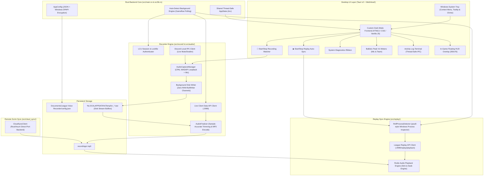

# System Architecture

The **League Voice Recorder & Replay Synchronizer** is engineered in native **Rust 2024** and **Tauri v2** for Windows 10/11 x64. It delivers zero-latency WASAPI hardware audio loopback capture, sample-accurate match clock synchronization, and native headless audio replay locking while maintaining a flat ~38 MB memory footprint with 0% idle CPU overhead.

---

## 1. High-Level System Architecture

---

## 2. Core Subsystems

### 2.1 UI Layer (Tauri v2 + WebView2)
- **Zero-Node Desktop Frontend**: Built with pure semantic HTML5, modern CSS3 variables (Hextech dark design system), and vanilla ES6+ JavaScript. No Node.js runtime or Chromium overhead at runtime; runs directly on the native Windows Evergreen WebView2 runtime.
- **Window Architecture**:
  - `main`: Primary desktop window (1100x960, resizable, auto-centered on launch).
  - `overlay`: Floating in-game HUD overlay (350x76, borderless, transparent, always-on-top).
  - `tray`: Windows notification area tray icon with context menu and dynamic match clock tooltip.

### 2.2 Audio Capture & Memory Architecture
- **Zero-RAM Disk-Streaming Engine**:
  - Unlike legacy systems that accumulate raw PCM buffers in memory (causing memory leaks of hundreds of megabytes during a 45-minute scrim), audio is streamed in real time to temporary files on disk:
    - `%LOCALAPPDATA%\Temp\lvr_mic_<PID>_<TIMESTAMP>.raw`
    - `%LOCALAPPDATA%\Temp\lvr_loopback_<PID>_<TIMESTAMP>.raw`
  - High-priority background writer threads consume fixed-size non-blocking MPSC channels and flush chunks directly to disk using `BufWriter<File>`.
  - Application RAM usage remains flat at **~38–41 MB** for the entire duration of the match, regardless of match length.

### 2.3 Sample-Accurate Timeline & Pause Lag Slicing
- **Clock Alignment (`first_game_time`)**: Captures the exact floating-point match clock timestamp reported by Riot's Live Client Data API (`:2999/liveclientdata/allgamedata`) at the millisecond capture engages.
  - If recording starts after `00:00:00` (`first_game_time > 0`), exact silence is prepended.
  - If recording starts during pre-game countdown (`first_game_time < 0`), pre-game audio is sample-accurately trimmed.
- **Zero-Drift Pause Detection**:
  - Live Client Data API freezes `gameTime` during match pauses (`gameTime == last_game_time` for >= 280ms).
  - Detection lag (~280ms) is permanently sliced out by truncating the on-disk raw stream files in-place (`pause_and_truncate_lag`).
  - Resuming resumes sequential streaming, completely eliminating cumulative clock drift across repeated pauses.

### 2.4 Headless Replay Playback Engine
- Replaces legacy VLC sub-process dependencies with native in-process Rust audio decoding via **Rodio** (`rodio::Sink`, `rodio::Decoder`).
- Instantaneous sub-millisecond timeline seeking without VLC seek-pipe stalls or audio stutter.
- Automatically adjusts playback rate (0.5x, 1x, 2x, 4x) in real time locked to `:2999/replay/playback`.

---

## 3. Technology Stack

| Layer | Technology | Purpose |
|---|---|---|
| **Language** | Rust 2024 (x86_64-pc-windows-gnu) | Core system engine, zero-cost memory safety |
| **Framework** | Tauri v2.0 | Native desktop application framework & IPC bridge |
| **GUI Runtime** | Microsoft Edge WebView2 | High-performance Windows rendering engine |
| **Audio Capture** | CPAL 0.18 + WASAPI | Native Windows Process Loopback & Microphones |
| **Audio Encoding** | `rusty_mp3` | Zero-dependency pure Rust MP3 encoding |
| **Replay Playback** | Rodio 0.23 | Native in-process audio decode & timeline sync |
| **Process Inspection** | `sysinfo` 0.33 | High-speed PID and cmdline `.rofl` inspection |
| **ID3 Tagging** | `id3` 1.16 | Studio-grade MP3 metadata tagging (scrim patch, Game ID) |
| **Secret Encryption**| Windows DPAPI (`CryptProtectData`) | Military-grade OS encryption for API secrets |
| **Async Runtime** | Tokio 1.43 (`features = ["full"]`) | Non-blocking HTTP and IPC task scheduling |
