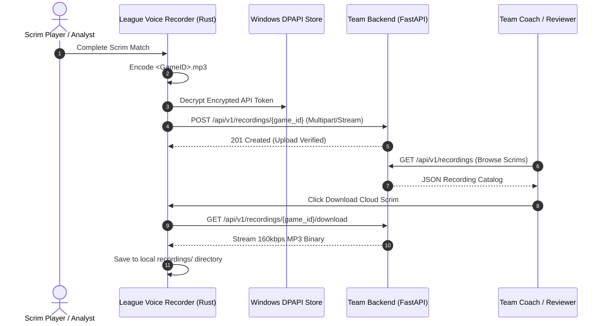

# Remote Scrim Cloud Sync

League Voice Recorder seamlessly integrates with the [league-voice-recorder-backend](https://github.com/betterix/league-voice-recorder-backend), a high-performance self-hosted FastAPI service designed for competitive esports teams, scrim aggregators, and coaching staff.

---

## 1. Overview & Data Flow

---

## 2. API Endpoints Reference

The client communicates with the backend via RESTful endpoints authenticated through bearer tokens or API key headers:

| Method | Endpoint | Description | Permitted Roles |
| :--- | :--- | :--- | :--- |
| `GET` | `/api/v1/health` | Returns server status, disk usage, and version info. | All (`admin`, `upload`, `pull`) |
| `GET` | `/api/v1/recordings` | Lists all team scrim recordings indexed on the server. | All (`admin`, `upload`, `pull`) |
| `GET` | `/api/v1/recordings/{id}/download` | Streams chunked MP3 audio for the given Game ID. | All (`admin`, `upload`, `pull`) |
| `POST` | `/api/v1/recordings/{id}` | Uploads a local MP3 recording with optional patch metadata. | `admin`, `upload` |
| `DELETE` | `/api/v1/recordings/{id}` | Deletes a recording from the team repository. | `admin` |

---

## 3. Windows DPAPI Secret Encryption

To prevent API credentials from leaking in plain-text through shared configs or backups, keys are encrypted using the Windows Data Protection API (DPAPI):

- **Encryption (`CryptProtectData`)**:
  - The API key is encrypted using the current Windows user's hardware-backed cryptographic credentials.
  - Stored in `config.json` as `remote_api_key_encrypted` (Base64-encoded ciphertext).
  - The plaintext key is zeroized from memory immediately after encryption.
- **Decryption (`CryptUnprotectData`)**:
  - On application startup, the ciphertext is decrypted strictly within the process memory space.
  - Keys cannot be decrypted by other users or copied to another machine.

---

## 4. Role-Based Access Control (RBAC)

The desktop client inspects the token permissions and dynamically adapts the UI:

| Role | Permissions | UI Adaptations |
| :--- | :--- | :--- |
| **`admin`** | Full access: View, Download, Upload, Delete. | Full action menu with red Delete buttons and manual upload options. |
| **`upload`** | View, Download, and Upload scrim audio. | Shows Upload buttons on local files and Download buttons on cloud items. |
| **`pull`** | Read-only access: View and Download scrims. | **Upload button is completely hidden** to prevent HTTP 403 Forbidden errors; displays clean "Pull-Only" role badge. |

---

## 5. Chunked Streaming & Resilience

- **Low-Memory Downloads**:
  - Cloud recordings are downloaded in streaming 64 KB chunks directly to temporary files (`<GameID>.mp3.part`) and atomically renamed upon completion.
  - Prevents RAM spikes regardless of match length.
- **Checksum Verification**:
  - Validates file integrity before registering in the local scrim library.
- **On-Demand Manual Sync**:
  - Scrims are only indexed when explicitly clicking the **☁ Sync Remote** toolbar button to minimize network traffic and keep application startup instantaneous.

---

## 6. Server Recording Management & Selective Delete

- **Precise Action Scoping**:
  - The "Remove from Server" action button appears strictly on recordings that have actually been uploaded and verified on the team backend.
  - Local recordings that have not been uploaded show only local actions ("Upload to Server", "Delete Local"), preventing confusion or invalid delete requests.
- **Admin Remote Delete (`DELETE /api/v1/recordings/{id}`)**:
  - Users with `admin` tokens can remove outdated or sensitive scrim recordings directly from the cloud repository without accessing the server shell or database.
