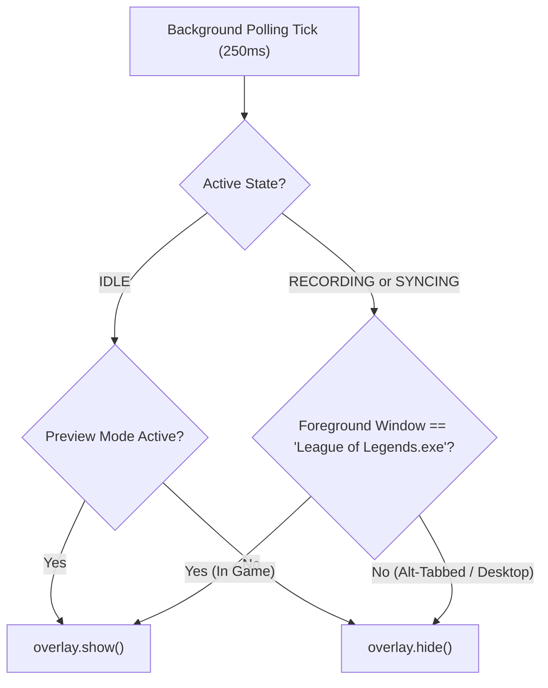

# In-Game Floating HUD Overlay

The League Voice Recorder includes a hardware-accelerated, transparent, floating in-game Heads-Up Display (HUD) overlay designed specifically for esports scrimmages and replay reviews.

The overlay runs inside a dedicated lightweight Tauri secondary webview window (`overlay`), floating topmost (`WS_EX_TOPMOST`) over *League of Legends* without drawing attention away from gameplay.

---

## 1. Specifications & Geometry

| Property | Value | Description |
| :--- | :--- | :--- |
| **Dimensions** | `350px × 76px` | Compact rectangular HUD designed to fit neatly above or below the game UI / minimap. |
| **Window Type** | Borderless Transparent | Window decorations disabled (`decorations: false`, `transparent: true`). |
| **Z-Order** | Always on Top | Configured with `alwaysOnTop: true` to stay visible above borderless/windowed game windows. |
| **Composite Opacity** | User Configurable (`0.40` – `1.00`) | The entire composite (`#overlay-card`) scales in opacity, preserving subpixel antialiasing and element contrast. |
| **Storage Key** | `hud_x`, `hud_y`, `hud_opacity`, `hud_locked` | Position and preferences persisted cleanly in `config.json`. |

---

## 2. Dual-Mode Visual Engine

The overlay automatically shifts modes based on the current application state:

### 2.1 Recorder HUD Mode (`RECORDING` / `PAUSED`)
Renders live audio monitoring to confirm team Discord chat and personal microphone capture during scrim matches:

- **Pulsing REC Badge**: High-visibility glowing crimson pill indicator (`🔴 REC`) pulsing at 1.2s cycles. Turns to yellow `⏸ PAUSED` during in-game pauses.
- **Match Clock Display**: Shows elapsed match time formatted as `MM:SS` (e.g. `14:28`), synchronized sample-accurately with the active League client clock.
- **Dual Visualizer Channels**:
  - **Microphone Channel (`#3DDCC4` Mint / Teal)**: Visualizes player mic input levels modulated via WASAPI PCM root-mean-square (RMS) energy.
  - **Discord Team Chat (`#8B93FF` Periwinkle)**: Visualizes incoming team Discord audio loopback levels.
- **GradeX Harmonics Generator**:
  - Employs 24-step precomputed harmonic coefficients ($H_0 \dots H_{23}$) with dual-frequency wave modulation:
    $$Y_i = \text{Base} \times \left(0.55 \sin(i \cdot 0.35 + t) + 0.45 \sin(i \cdot 0.7 + t \cdot 1.4)\right)$$
  - Renders smooth 60 FPS rounded vertical bars with zero CPU overhead, boosting low-level voice presence so players can immediately verify capture.

### 2.2 Replay HUD Mode (`SYNCING` / `PAUSED`)
Provides intuitive playback feedback and volume adjustments when reviewing `.rofl` replays:

- **Needle Waveform Display**:
  - Renders a multi-segment timeline waveform across a 130px canvas.
  - **Passed Audio**: Displayed in vibrant `#3DDCC4` (Hextech Teal).
  - **Playhead Needle**: Crisp 2px white indicator (`#FFFFFF`) with glowing drop-shadow.
  - **Upcoming Audio**: Muted dark slate (`#3C4655`).
- **Interactive Volume Slider**:
  - A custom slider allowing 0% to 100% volume adjustment.
  - Direct real-time sync with Rodio's playback sink (`sink.set_volume(vol)`).
- **Status Indicator**:
  - Displays `▶ REPLAY` when audio is tracking the replay timeline, or `⏸ PAUSED` when the match is stopped or scrubbing.

---

## 3. Anti-Bleed Window Focus Guard

To prevent the overlay from interfering with normal desktop use (browsing, Discord chat, champion select, or lobby):

1. **ChampSelect Pre-Warming**:
   - The overlay webview is created and pre-warmed in memory on application launch, incurring zero loading hitch when the game engine boots.
   - It remains completely hidden (`win.hide()`) throughout Lobby and ChampSelect.
2. **Instant Loading Screen Launch**:
   - The exact moment `League of Legends.exe` appears in the foreground, the overlay becomes visible.
3. **Alt-Tab Smart Isolation**:
   - Using native Win32 `GetForegroundWindow` and `GetWindowThreadProcessId`, the monitor identifies when the user switches away from League (e.g. to Discord, Chrome, or Windows desktop).
   - The overlay immediately hides to keep the desktop clutter-free, and instantly re-appears when switching back to the game.

---

## 4. Native Dragging & Click-Through Hit Testing

### 4.1 Unlocked Drag Mode (`hud_locked = false`)
- Users can click anywhere on the HUD background to move the window across any monitor.
- Mouse movement uses Tauri's native window dragging API (`win.start_dragging()`), which hooks directly into the Windows OS window manager for stutter-free dragging across high-refresh-rate displays.
- Right-clicking the HUD in unlocked mode opens a context menu with options to **Lock Position** (`🔒 Lock Position`) or **Reset Position** (`🎯 Reset Position`).
- When released (`mouseup`), the window coordinates are retrieved via `win.outer_position()` and persisted into `config.json` (`hud_x`, `hud_y`).

### 4.2 Click-Through & Forwarding Mode (`hud_locked = true`)
- When locked, mouse right-clicks and left-clicks on the HUD background are permanently disabled from triggering menus or dragging.
- **Direct Input Forwarding**: Any mouse click (left or right) hitting the HUD card is forwarded directly into the underlying game engine or desktop window beneath, ensuring 100% uninterrupted champion movement, ability targeting, or camera panning.
- **Dedicated Interactive Lock Hit Target**:
  - The **Lock Icon** (`#lock-hit`) is the only interactive control enabled during lock mode, allowing players to easily unlock the overlay at any time without Alt-Tabbing.

---

## 5. Preview Mode

From the **Settings** tab in the main desktop UI, users can test and position the HUD at any time without starting League:
- **Preview Rec HUD**: Simulates a live match with synthesized voice waveforms and running match timer.
- **Preview Replay HUD**: Simulates replay synchronization with active waveform needle and volume controls.
- **Position Reset**: Instantly resets the HUD back to monitor center (`x = 100, y = 100`).
