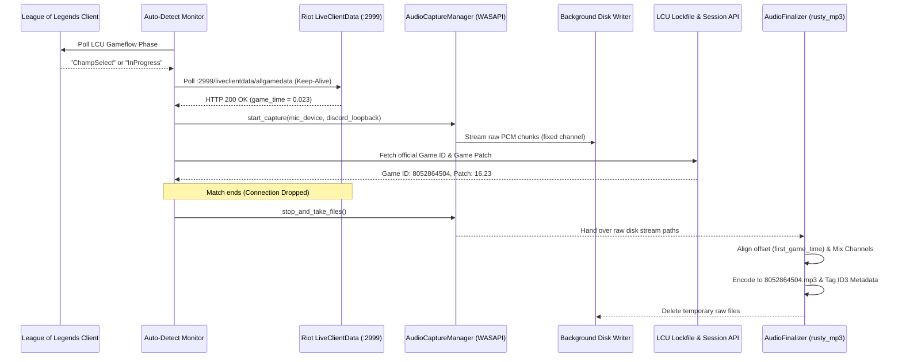

# Automated Scrim Voice Recording (`src/record/` & `src/audio/`)

The Recording Engine is designed for competitive League of Legends teams to capture studio-grade communications with zero setup friction, zero manual button pressing, and frame-accurate match clock synchronization.

---

## 1. Zero-Latency Match Detection & Lifecycle

---

## 2. Audio Capture Architecture (`src/audio/capture.rs`)

### 2.1 Native Windows WASAPI Loopback
- Captures team Discord audio directly using Windows Audio Session API (WASAPI) process loopback.
- Automatically isolates voice communications without desktop background noise, game sounds, or music bleed.
- Dynamically resamples incoming hardware sample rates (44.1 kHz, 48 kHz, 96 kHz, 192 kHz) to studio standard **48,000 Hz, 16-bit Stereo PCM**.

### 2.2 Player Microphone Capture
- Captures player speech with selectable microphone hardware device or Windows default input.
- Ballistic peak VU meters report real-time levels (0.0 to 1.0) with snappy instantaneous attack and silky exponential decay.

### 2.3 Live VU Meter When Idle (Zero-Allocation Preview)
- When not actively in a match, `start_preview()` spins up a lightweight level monitor.
- Animates the UI microphone and loopback volume bars immediately upon opening the application without creating files or writing to disk.

---

## 3. Sample-Accurate Offset Alignment

A primary issue with traditional screen recorders is that pressing record manually produces an arbitrary start offset relative to League of Legends match time `00:00:00`.

The engine solves this with mathematical sample-accurate alignment:
1. Stores `first_game_time = game_time` at the exact millisecond audio capture engages.
2. When the match client closes:
   - **Late Start (`first_game_time > 0.0`)**: Pre-pads the stream with exact zero-byte silence frames:
     $$\text{silence\_frames} = \lfloor \text{first\_game\_time} \times 48000 \rfloor$$
   - **Countdown Start (`first_game_time < 0.0`)**: Skips the pre-game countdown audio frames:
     $$\text{skip\_frames} = \lfloor |\text{first\_game\_time}| \times 48000 \rfloor$$
3. Result: In the exported MP3 file, audio timestamp `00:00:00` coincides **frame-by-frame** with League match time `00:00:00`.

---

## 4. Zero-Drift Pause Detection & WAV Slicing

In tournament and scrim environments, games frequently pause (`/pause`):
- Riot's Live Client Data API freezes `gameTime` during pauses.
- Because HTTP polling takes approximately **280ms** to confirm that the game clock has frozen, ~280ms of audio is recorded after the match paused.
- Without correction, repeated pauses cause cumulative clock drift.
- **In-Place Lag Truncation (`pause_and_truncate_lag`)**:
  - Slices out detection lag by seeking back and truncating the on-disk raw files:
    $$\text{truncate\_bytes} = \text{lag\_ms} \times \frac{48000 \text{ Hz} \times 2 \text{ channels} \times 2 \text{ bytes}}{1000 \text{ ms}}$$
  - When the game resumes, recording continues sequentially with zero timeline drift.

---

## 5. Discord Local IPC Mute & Deafen Tracking

- Connects to Discord's local Named Pipe (`\\.\pipe\discord-ipc-*`).
- Subscribes to `VOICE_SETTINGS_UPDATE` events.
- When the user mutes or deafens in Discord:
  - Suppresses the microphone stream by feeding synchronized zero bytes (`0i16`).
  - Team communications from Discord loopback are **never muted**, ensuring teammates' callouts remain recorded.
  - Keeps the match clock sample-accurate without requiring manual push-to-mute toggling.

---

## 6. Scrim Metadata, ID3v2 Tags & Patch Mismatch Detection

### 6.1 Studio-Grade ID3v2 Tagging (`src/scrim_meta/id3.rs`)
- When encoding `<GameID>.mp3`, official match context is embedded directly into ID3v2 frames:
  - **Game ID**: Encoded in ID3 title (`TIT2`) and custom user-defined text frame (`TXXX:GameId`).
  - **Game Patch**: Encoded in comment (`COMM`) and custom frame (`TXXX:GamePatch`) fetched directly from LCU.
  - **Team Tag & Notes**: Custom metadata frames preserved across transfers and cloud uploads.

### 6.2 Out-of-Patch Visual Alert
- Scrim reviews often suffer when a `.rofl` replay cannot be played in League because the game has since updated to a newer patch.
- The desktop recording explorer continuously compares the embedded `GamePatch` of each recording against the active League client patch.
- If a recording's patch does not match the active game patch, it is highlighted with a prominent reddish border, alert badge, and patch warning indicator so players and coaches instantly know it belongs to a previous patch.
