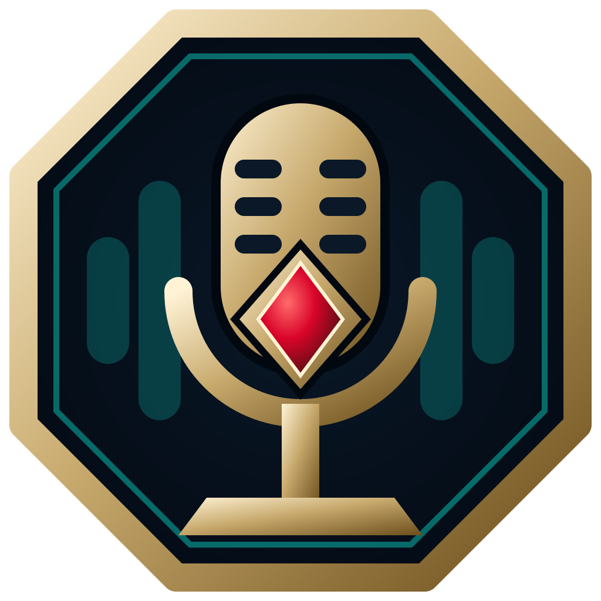

# 🌐 League Voice Recorder & Replay Synchronizer — Official Web Showcase

<p align="center">
  
</p>

<p align="center">
  <strong>The official modern landing page and interactive showcase for <a href="https://github.com/betterix/league-voice-recorder">League Voice Recorder</a>.</strong>
</p>

<p align="center">
  <a href="https://github.com/betterix/league-voice-recorder/releases"></a>
  
  
  
</p>

---

## ✨ Features of the Website

- 🎮 **Hextech Esports Aesthetic**: Deep Obsidian Void backgrounds, Hextech Gold gradients, and Zaun Magic Cyan glowing accents with dynamic interactive particle animations.
- 🧪 **Live Desktop App Simulator**: An interactive in-browser replica of the CustomTkinter desktop interface:
  - Working **Start/Stop Recording Watcher** cycle with match launch simulation.
  - Responsive **audio VU meters** for Discord loopback and player microphone.
  - Interactive **Discord Mute Test button** demonstrating real-time silence byte injection without timeline desync.
  - Interactive **Replay scrub slider**, speed multiplier switches (`0.5x`, `1.0x`, `2.0x`, `4.0x`), volume slider, and **`M`** hotkey mute listener.
  - Realistic color-coded **Activity Log** console.
  - **Scrim Recordings Explorer** with synthesized procedural Web Audio sample playback.
- 🌐 **Instant Multi-Language Switcher (EN & HU)**: Toggle smoothly between English and Hungarian (Magyar) across the entire page, matching the desktop application's native translations.
- ⏱️ **Audio Precision Timeline Visualizer**: Interactive diagram highlighting why frame-accurate sample math eliminates manual review desync.
- 📋 **Tabbed Setup & Configuration Guide**:
  1. Standalone `.zip` release instructions.
  2. One-click copyable `winget` commands for FFmpeg and VLC 64-bit.
  3. `game.cfg` Replay API helper with copyable `EnableReplayApi=1` block.
  4. Discord Local IPC StreamKit authorization walkthrough.
  5. Run from Python source instructions using `uv`.
- 🩺 **System Diagnostics Ribbon**: Interactive replica of the top health status bar (Discord IPC, League Client, VLC 64-bit, and FFmpeg) with simulation refresh.
- 🛡️ **Vanguard & Security Audits**: Clear technical explainers detailing zero memory injection, official localhost Riot APIs, and Discord named pipes.
- ❓ **FAQ Accordion**: Comprehensive answers to questions from players and coaches.

---

## 🚀 Local Preview

You can open `index.html` directly in any web browser, or launch a local preview server with Python:

```powershell
# Inside the web/ directory
cd web
python -m http.server 8080
```

Then visit:
`http://localhost:8080`

---

## 📂 Project Structure

```text
web/
├── assets/
│   ├── icon.ico           # Windows multi-res app icon
│   ├── icon.png           # High-resolution raster logo
│   └── icon.svg           # Scalable Hextech vector badge
├── css/
│   └── style.css          # Design system, glassmorphism, responsive styles
├── js/
│   └── app.js             # Particle canvas, i18n dictionary, interactive app simulator
├── index.html             # Main semantic, SEO-optimized landing page
└── README.md              # Documentation
```

---

## 📜 License & Attribution

- **License**: GNU General Public License v3.0 (GPL-3.0)
- **App Repository**: [betterix/league-voice-recorder](https://github.com/betterix/league-voice-recorder)
- **Disclaimer**: *League Voice Recorder is an independent open-source project and is not endorsed by, directly affiliated with, maintained, authorized, or sponsored by Riot Games, Inc. League of Legends is a trademark or registered trademark of Riot Games, Inc.*
